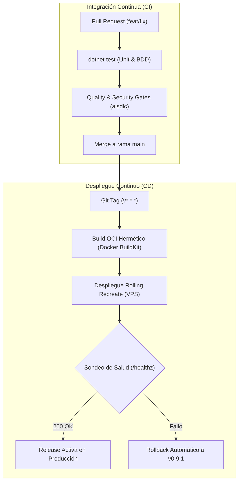

# MAN-PROD-ESCANDALLO-001: Manual de Producción y Operaciones - Escandallo Estética

## 1. Regeneración Determinista de la Release (Reproducible Builds)

Esta sección especifica las directivas requeridas para reconstruir bit a bit y de forma determinista los artefactos desplegables de **Escandallo Estética** a partir de su etiqueta Git inmutable.

### 1.1 Línea Base del Código Fuente

- **Repositorio Canónico**: `https://github.com/altromon/EscandalloFull.git`
- **Etiqueta Git Inmutable**: `v1.0.0`
- **Rama de Integración Productiva**: `main`
- **Comando de Clonado Limpio**:
  ```bash
  git clone --recurse-submodules https://github.com/altromon/EscandalloFull.git
  cd EscandalloFull
  git checkout tags/v1.0.0
  ```

### 1.2 Matriz de Herramientas y Toolchains Congelados

| Herramienta / Runtime | Versión Exacta | Digest / Checksum | Propósito |
| :--- | :--- | :--- | :--- |
| **.NET SDK** | 10.0.100 (LTS) | Pinned en `global.json` | Compilador C# 13 y empaquetado de ensamblados |
| **Linux Base Image** | `mcr.microsoft.com/dotnet/aspnet:10.0-chiseled` | `sha256:aspnet-10.0-chiseled` | Contenedor minimalista sin shell para ejecución |
| **PostgreSQL Engine** | `16.4-alpine` | `sha256:postgres-16.4-alpine` | Base de datos relacional y auditoría append-only |
| **Docker BuildKit** | `>= 0.18.0` | `moby/buildkit:v0.18.0` | Motor de compilación hermético OCI |

### 1.3 Grafo de Dependencias, Paquetes y Licencias

- **Lockfile de Paquetes NuGet**: `packages.lock.json` habilitado mediante `<RestorePackagesWithLockFile>true</RestorePackagesWithLockFile>`. La restauración abierta queda prohibida (`dotnet restore --locked-mode` obligatorio).
- **Gobernanza de Licencias**:
  - **Política vinculante**: `license-policy.yaml`.
  - **Dependencias de terceros homologadas**: Permisivas (MIT, Apache-2.0, BSD-3-Clause). Prohibidas licencias copyleft víricas (GPLv3, AGPLv3).
  - **Verificación determinista**:
    ```bash
    pnpm verify:licenses
    ```
- **Inventario SBOM**:
  - **Formato**: CycloneDX JSON v1.5 / SPDX v2.3.
  - **Ruta de compilación**: `reports/sbom-cyclonedx.json`.

### 1.4 Procedimiento de Compilación Determinista Paso a Paso

#### Paso 1: Restauración Hermética de Dependencias
```bash
dotnet restore Escandallo.sln --locked-mode
```

#### Paso 2: Verificación de Tipos y Suite de Pruebas Automatizadas
```bash
dotnet test --configuration Release --no-restore
```

#### Paso 3: Compilación y Publicación del Artefacto Web (.NET 10)
```bash
export SOURCE_DATE_EPOCH=$(git log -1 --pretty=%ct)
dotnet publish src/Escandallo.Web/Escandallo.Web.csproj \
  --configuration Release \
  --no-restore \
  --output dist/app
```

#### Paso 4: Verificación Criptográfica del Artefacto Generado
```bash
sha256sum dist/app/Escandallo.Web.dll
```

---

## 2. Matriz de Compatibilidad de Versiones, Infraestructura y Migración

Esta sección delimita las fronteras operativas entre componentes para soportar despliegues de coste ultrabajo (< 15 €/mes, `QR-DEPLOY-COST-001`) con tolerancia a fallos 24/7 (`QR-AVAILABILITY-001`).

### 2.1 Compatibilidad de Plataforma y Runtime de Ejecución

| Componente de Infraestructura | Rango Aprobado | Versión Homologada | Estado de Soporte |
| :--- | :--- | :--- | :---: |
| **Sistema Operativo Anfitrión** | Ubuntu 22.04 LTS / Debian 12 | Ubuntu 22.04 LTS (Kernel 6.x) | ✅ Homologado |
| **Hardware VPS Mínimo** | 2 vCPU / 4 GB RAM / 40 GB NVMe | Hetzner Cloud CX22 (~4 €/mes) | ✅ Homologado |
| **Container Runtime** | Docker Engine >= 25.0 / containerd | Docker CE 26.1 | ✅ Certificado |
| **Runtime .NET en Producción** | .NET 10.x LTS | 10.0-chiseled Linux | ✅ Hermético |
| **Base de Datos Relacional** | PostgreSQL 15.x - 16.x | PostgreSQL 16.4 Alpine | ✅ Certificado |
| **Almacenamiento S3 (DR/WAL)** | Compatible con AWS S3 API | Cloudflare R2 (Cero Egress Fees) | ✅ Certificado |

### 2.2 Compatibilidad de Esquemas de Datos y Migraciones (Soporte N-1)

Para garantizar actualizaciones sin pérdida de servicio (Zero-Downtime Deployments):

| Versión de Release | Versión de Esquema BD | Soporte $N-1$ | Estado de la Migración |
| :---: | :---: | :---: | :--- |
| **v1.0.0** (Actual) | `SCHEMA-v1.0` | ✅ Sí | Migración aditiva estricta: creación de tablas con valores por defecto; cero renombrado de columnas destructivo. |
| **v0.9.x** | `SCHEMA-v0.9` | ✅ Línea previa | Totalmente compatible durante el drenado de conexiones activas. |

### 2.3 Interoperabilidad entre Componentes de Arquitectura (CMP-*)

| Componente Dependiente | Componente Consumido | Contrato / Protocolo Vinculante | Enclave Asociado |
| :--- | :--- | :--- | :--- |
| `CMP-WEB-UI-001` (SPA) | `CMP-AUTH-GATEWAY-001` | REST / HTTPS JSON (`auth-api.json`) | `SEC-ENC-AUTH-GATEWAY-001` |
| `CMP-AUTH-GATEWAY-001` | `CMP-DATA-ACCESS-001` | In-Process LINQ / EF Core DbContext | `SEC-ENC-DATA-ACCESS-001` |
| `CMP-WEB-UI-001` (SPA) | `CMP-COST-ENGINE-001` | REST / HTTPS JSON (`costs-api.json`) | `SEC-ENC-SERVICE-CORE-001` |
| `CMP-COST-ENGINE-001` | `CMP-MARGIN-CALCULATOR-001` | In-Process Domain API (`decimal` 128-bit) | `SEC-ENC-SERVICE-CORE-001` |
| `CMP-SUBSCRIPTION-MGR-001` | Stripe Payment Gateway | Webhook HMAC-SHA256 (`Stripe-Signature`) | `SEC-ENC-PAYMENT-INTEGRATION-001` |
| `CMP-EXPORT-DOC-001` | Motor de Renderizado | QuestPDF Sandbox / ClosedXML Anti-Formula | `SEC-ENC-EXPORT-SANDBOX-001` |
| `CMP-DEMO-MGR-001` | `CMP-DATA-ACCESS-001` | Transacciones filtradas por `is_demo = true` | `SEC-ENC-DATA-ACCESS-001` |

### 2.4 Rutas Homologadas de Actualización y Rollback

| Versión Origen | Salto Directo a v1.0.0 | Migración Intermedia Requerida | Procedimiento de Rollback |
| :---: | :---: | :---: | :--- |
| **v0.9.1** | ✅ Permitido | ❌ No requerida | Reversión de imagen Docker a tag previo sin rollback de base de datos. |
| **v0.9.0** | ✅ Permitido | ❌ No requerida | `docker compose up -d --no-deps escandallo-app:v0.9.0` |
| **< v0.9.0** | ❌ Bloqueado | ✅ Requiere paso previo a v0.9.1 | Requiere restauración de snapshot WAL desde Cloudflare R2. |

---

## 3. Arquitectura CI/CD y Pipelines de Despliegue

### 3.1 Modelo de Ramificación Jerárquico y Disparadores

```text
TIER 1: main (Producción)
  ▲
  └── PR Release Gate (Aprobación del Tech Lead / Release Manager + 100% Quality Gates)
        │
TIER 2: release/v1.0.0 (Rama de Estabilización)
  ▲
  └── PR Feature Gate (Lint + Typecheck + Pruebas Unitarias/UI + Schemas + SAST)
        │
TIER 3: feat/CHG-* / fix/CHG-* (Desarrollo Atómico)
```

- **Disparador de Pull Request**: Ejecuta verificación estricta de calidad, cobertura BDD, análisis estático y linters.
- **Disparador por Tag (`v*.*.*`)**: Compila imágenes Docker herméticas, ejecuta tests de humo y despliega al servidor VPS.

### 3.2 Diagrama de Flujo del Pipeline CI/CD



### 3.3 Umbrales y Contratos de los Release Gates

| Quality Gate | Herramienta / Comando | Umbral Requerido | Acción ante Incumplimiento |
| :--- | :--- | :--- | :--- |
| **Compilación y Tipado** | `dotnet build --configuration Release` | Cero advertencias como error, cero errores | Fallo inmediato del build |
| **Suite de Pruebas** | `dotnet test` | 100% exitosas, Cobertura >= 85% | Fallo inmediato del build |
| **Complejidad Ciclomática** | `aisdlc verify quality` | CC $\le$ 10 por método | Release bloqueada |
| **Índice Mantenibilidad** | `aisdlc verify quality` | MI $\ge$ 50.0 / 100 | Release bloqueada |
| **Trazabilidad 360°** | `aisdlc verify traceability` | 100% requisitos mapeados a tests | Release bloqueada |
| **Gobernanza Licencias** | `aisdlc verify licenses` | Cero licencias incompatibles | Release bloqueada |
| **Sondas de Salud** | `curl -f http://127.0.0.1:5100/healthz` | HTTP 200 OK en < 200 ms | Rollback automático |

---

## 4. Estrategia y Procedimiento de Despliegue en Producción

### 4.1 Requisitos Previos de Infraestructura y Enclaves de Red

#### Enclaves Involucrados
- **`SEC-ENC-AUTH-GATEWAY-001`**: Perímetro DMZ, puerto 443 expuesto vía Caddy/Nginx con TLS 1.3.
- **`SEC-ENC-SERVICE-CORE-001`**: Núcleo de cálculo en contenedor privado.
- **`SEC-ENC-DATA-ACCESS-001`**: PostgreSQL 16 en red Docker interna `escandallo-net`, sin puertos expuestos al host.
- **`SEC-ENC-EXPORT-SANDBOX-001`**: Renderizado QuestPDF y XLSX sanitizado.
- **`SEC-ENC-PAYMENT-INTEGRATION-001`**: Receptor webhook Stripe.

#### Gestión de Secretos
Parámetros sensibles inyectados mediante variables de entorno seguras de Docker (`chmod 600`):
- `POSTGRES_PASSWORD`
- `JWT_SECRET_KEY` (clave simétrica HMAC-SHA256 de al menos 256 bits)
- `STRIPE_WEBHOOK_SECRET`
- `R2_ACCESS_KEY` y `R2_SECRET_KEY`

### 4.2 Estrategia de Rollout

Se aplica una estrategia **Rolling Recreate** con Healthcheck estricto:
1. Comprobación de estado del nodo y creación de snapshot transaccional de PostgreSQL.
2. Descarga de la nueva imagen de contenedor `escandallo-app:v1.0.0`.
3. Ejecución de migraciones EF Core idempotentes (`dotnet ef database update`).
4. Reemplazo del contenedor y sondeo continuo a `/healthz` y `/readyz`.

### 4.3 Procedimiento de Despliegue Paso a Paso

#### Paso 1: Comprobación de Salud Previa y Snapshot de Respaldo
```bash
docker compose ps
curl -f http://127.0.0.1:5100/healthz
docker exec -t escandallo-db pg_dump -U postgres -d escandallodb -F c -b -v -f /backups/pre-deploy-v1.0.0.dump
```

#### Paso 2: Descarga e Inicio de Contenedores con la Nueva Release
```bash
docker compose pull escandallo-app
docker compose up -d --no-deps escandallo-app
```

#### Paso 3: Verificación de Sondas de Vitalidad y Preparación
```bash
curl -i http://127.0.0.1:5100/healthz
curl -i http://127.0.0.1:5100/readyz
```

#### Paso 4: Auditoría de Consumo de Recursos en Reposo (QR-DEPLOY-COST-001)
```bash
docker stats --no-stream --format "table {{.Name}}\t{{.CPUPerc}}\t{{.MemUsage}}\t{{.MemPerc}}"
# escandallo-app debe consumir < 150 MB de memoria RAM en reposo
```

### 4.4 Plan de Rollback (Marcha Atrás Inmediata)

#### Criterios Objetivos de Activación del Rollback
- Endpoint `/healthz` o `/readyz` responde con código HTTP $\ne 200$ transcurridos 60 segundos desde el inicio.
- Tasa de errores HTTP 5xx superior al 0.05% en las peticiones entrantes durante los primeros 5 minutos.
- El contenedor supera el umbral crítico de 200 MB de RAM de forma persistente.

#### Comandos de Ejecución de Rollback
```bash
docker compose stop escandallo-app
docker compose up -d --no-deps escandallo-app:v0.9.1
# Si se requiere restauración de snapshot de base de datos:
docker exec -t escandallo-db pg_restore -U postgres -d escandallodb --clean --if-exists /backups/pre-deploy-v1.0.0.dump
curl -f http://127.0.0.1:5100/healthz
```

---

## 5. Resolución de Incidencias Frecuentes y Runbooks Operativos (Troubleshooting)

### 5.1 Matriz de Incidentes Frecuentes y Soluciones

#### Incidente 1: Violación de Membresía Multi-inquilino o Intento de Tenant Hopping
- **Síntoma**: Registros de error HTTP 403 Forbidden con código de seguridad `TENANT_MEMBERSHIP_VIOLATION` en logs de `CMP-AUTH-GATEWAY-001`.
- **Causa Raíz**: Un usuario intenta seleccionar o consultar un centro (`CenterId`) al que no pertenece su cuenta (`UserId`), infringiendo `SEC-REQ-AUTH-MEMBER-001`.
- **Diagnóstico**:
  ```bash
  docker logs escandallo-app --tail 100 | grep "TENANT_MEMBERSHIP_VIOLATION"
  ```
- **Mitigación**:
  - Verificar si se trata de un intento hostil de manipulación o un error de sincronización de caché en frontend.
  - Si la membresía es legítima pero no está sincronizada, verificar la tabla relacional `user_center_memberships`.
  - No requiere reinicio de servicios; el middleware intercepta y bloquea la petición perimetralmente.

#### Incidente 2: Falla de Firma HMAC en Webhooks de Stripe (SEC-REQ-STRIPE-SIGNATURE-001)
- **Síntoma**: Endpoint `/api/v1/billing/stripe-webhook` responde con HTTP 400 Bad Request y log `STRIPE_SIGNATURE_VERIFICATION_FAILED`.
- **Causa Raíz**: El secreto de webhook configurado (`STRIPE_WEBHOOK_SECRET`) ha expirado o no coincide con el configurado en el Dashboard de Stripe, o el timestamp del evento supera los 300 segundos de antigüedad (ataque de repetición mitigado).
- **Diagnóstico**:
  ```bash
  docker logs escandallo-app --tail 50 | grep "Stripe-Signature"
  ```
- **Mitigación**:
  - Comprobar en el panel de Stripe que la clave de firma del webhook coincide exactamente con la variable de entorno.
  - Actualizar el secreto en `.env.production` si fue regenerado.
  - Recrear el contenedor con `docker compose up -d --no-deps escandallo-app`.

#### Incidente 3: Pico de Memoria o Bloqueo en Generación de Informes PDF (SEC-ENC-EXPORT-SANDBOX-001)
- **Síntoma**: Alerta del host VPS indicando consumo de memoria superior a 150 MB tras solicitudes de exportación ejecutiva.
- **Causa Raíz**: Peticiones concurrentes masivas de generación documental PDF con QuestPDF.
- **Diagnóstico**:
  ```bash
  docker stats escandallo-app --no-stream
  docker logs escandallo-app --tail 100 | grep -i "OutOfMemory"
  ```
- **Mitigación**:
  - Comprobar que el semáforo de concurrencia de exportación documental (`SemaphoreSlim` a 2 tareas simultáneas) está activo en `CMP-EXPORT-DOC-001`.
  - Verificar que ninguna URL remota está siendo resuelta durante el renderizado (bloqueo SSRF según `SEC-REQ-EXPORT-SANITIZATION-001`).
  - Forzar liberación de memoria mediante reinicio controlado: `docker compose restart escandallo-app`.

#### Incidente 4: Ruptura de Cadena Criptográfica SHA-256 en Registro de Auditoría
- **Síntoma**: El job de verificación de integridad o auditoría detecta una discrepancia en `cost_audit_log` con mensaje `AUDIT_HASH_CHAIN_BROKEN`.
- **Causa Raíz**: Intento de modificación directa en base de datos mediante bypass de EF Core, violando `SEC-REQ-AUDIT-IMMUTABLE-001` y `ADR-004`.
- **Diagnóstico**:
  ```sql
  SELECT id, center_id, timestamp_utc, prev_hash, entry_hash
  FROM cost_audit_log
  ORDER BY id ASC;
  ```
- **Mitigación**:
  - Identificar la fila exacta donde el hash calculado no coincide con el `prev_hash` encadenado.
  - Notificar inmediatamente a SecOps y al oficial de cumplimiento como incidente de seguridad de integridad financiera.
  - Auditar los accesos de superusuario a la instancia de PostgreSQL.

### 5.2 Protocolo de Escalado y Gestión de Incidentes Críticos

| Nivel de Severidad | Criterio de Impacto | Tiempo Máximo de Respuesta | Roles Involucrados |
| :--- | :--- | :---: | :--- |
| **SEV-1 (Crítico)** | Caída total del servicio, indisponibilidad de PostgreSQL o brecha en aislamiento multi-inquilino. | 15 minutos | SRE On-call + Lead Architect + SecOps |
| **SEV-2 (Mayor)** | Falla en pasarela de pagos Stripe, degradación de latencia > 500 ms o fallos en cálculo de escandallos. | 1 hora | SRE On-call + Tech Lead |
| **SEV-3 (Menor)** | Error aislado en exportación documental PDF o fallo visual en semáforo de rentabilidad. | 4 horas | DevOps Engineer / Desarrollador de Guardia |

---

## 6. Historial de Revisiones y Control de Versiones

| Versión | Fecha | Autor / Agente | Descripción del Cambio | Referencia de Cambio |
| :---: | :---: | :--- | :--- | :---: |
| **1.0.0** | 2026-10-17 | agent-developer | Generación inicial del Manual de Producción conforme a plantillas AI-SDLC y esquema canónico | `CHG-REMEDIATION-002` |