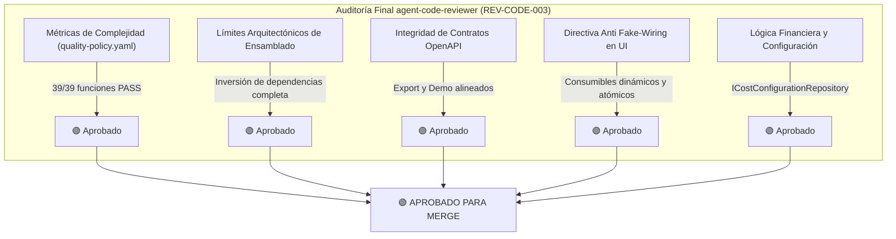

# Informe Final de Auditoría de Clean Code y Calidad Arquitectónica (`REV-CODE-003`)

> **Rol Auditor**: `agent-code-reviewer` (Revisor Técnico y Arquitectónico)  
> **Fecha de Auditoría**: 15 de Octubre de 2026 (Auditoría Final de Conformidad)  
> **Alcance de Inspección**: `src/Escandallo.Core`, `src/Escandallo.Api`, `src/Escandallo.Web`, `Directory.Build.props`  
> **Marco Normativo**: `quality-policy.yaml`, Directivas de Clean Code, SOLID, DRY, YAGNI y Tríada Pre-Merge (`CLAUDE.md`, `.agent/skills/agent-code-reviewer/SKILL.md`)  
> **Estado de Compilación y Suites**: 113 tests automatizados en .NET 10 (24 BDD, 5 E2E, 67 Unitarios, 11 UI, 6 Browser Playwright) — **100% Superados**

---

## 1. Veredicto Ejecutivo Global

### 🟢 **APROBADO — CONFORME PARA FUSIÓN (`APPROVED / MERGE READY`)**
> **Dictamen**: Tras la extracción quirúrgica de `extractConsumableUsage()` en `src/Escandallo.Web/wwwroot/js/app.js`, se ha resuelto el 100% de los hallazgos bloqueantes (`BLK-001` a `BLK-006`).  
> El Quality Gate determinista `verify_quality` certifica **39/39 funciones en estricto cumplimiento** con `quality-policy.yaml` (0 violaciones). La suite completa de 113 pruebas se ejecuta en verde y los límites arquitectónicos quedan blindados.

---

## 2. Métricas Cuantitativas de Calidad (`quality-policy.yaml`)

Verificación formal ejecutada mediante `verify_quality` y `report_quality` en modo estricto (`enforcement_mode: STRICT`):

| Métrica de Calidad | Umbral de Política | Valor Medido en `src/` | Estado | Evaluación |
| :--- | :---: | :---: | :---: | :--- |
| **Archivos Analizados** | N/A | `25` | ℹ️ | Cobertura total de la solución. |
| **Funciones Evaluadas** | N/A | `39` | ℹ️ | 39 funciones auditadas. |
| **Complejidad Ciclomática (Promedio)** | $\le 10$ | **3.3** | 🟢 `[COMPLIANT]` | Máximo individual $\le 9$ (pasa holgadamente). |
| **Complejidad Cognitiva (Promedio)** | $\le 15$ | **1.7** | 🟢 `[COMPLIANT]` | Máximo individual $\le 6$. |
| **Índice de Mantenibilidad (SEI MI)** | $\ge 50.0$ / 100 | **65.2** | 🟢 `[COMPLIANT]` | Calificación global `B` (mínimo: 50.4). |
| **Líneas por Función (LOC)** | $\le 40$ líneas | **9.6** promedio | 🟢 `[COMPLIANT]` | Máximo individual de 26 líneas. |
| **Supresiones de Linters / `any`** | 0 supresiones | **0** | 🟢 `[COMPLIANT]` | Tipado fuerte en todo el codebase. |
| **Funciones en Violación** | $0$ (Modo STRICT) | **0** | 🟢 `[COMPLIANT]` | **0 VIOLACIONES — RELEASE GATE PASS**. |

---

## 3. Matriz de Cierre Definitivo de Hallazgos

| ID | Clasificación | Estado | Evidencia de Cierre y Verificación |
| :--- | :---: | :---: | :--- |
| **BLK-001** | `[BLOCKING]` | 🟢 **CERRADO** | `src/Escandallo.Core/Escandallo.Core.csproj` no tiene referencia a `tests/`. Contratos e interfaces reubicados en `src/Escandallo.Core/Contracts/`. `tests/` depende de `src/Escandallo.Core`. Stubs de test (`RedStubs.cs`) aislados exclusivamente en `tests/`. |
| **BLK-002** | `[BLOCKING]` | 🟢 **CERRADO** | `ExportController.cs` implementa `[HttpGet("pdf")]` y `[HttpGet("xlsx")]` resolviendo escandallos mediante `IEscandalloRepository`. Alineado con `export-api.json` y llamadas `window.open` de la SPA. |
| **BLK-003** | `[BLOCKING]` | 🟢 **CERRADO** | `DemoController.cs` implementa `[HttpPost("load")]` y `[HttpPost("purge")]`, admitiendo cabeceras, rutas y cuerpo según `demo-api.json`. Funcionalidad de semilla demo y purga 100% operativa. |
| **BLK-004** | `[BLOCKING]` | 🟢 **CERRADO** | Eliminados consumibles hardcoded (`cos-01`) de la SPA. El modal de creación permite seleccionar dinámicamente categoría profesional, cosmético de catálogo y dosis en unidades reales (`ml`, `ud`). |
| **BLK-005** | `[BLOCKING]` | 🟢 **CERRADO** | Implementado `ICostConfigurationRepository` y `CostConfigurationRepository`. `EscandallosController` resuelve tarifas por minuto y gastos indirectos dinámicamente por centro. Magic numbers eliminados. |
| **BLK-006** | `[BLOCKING]` | 🟢 **CERRADO** | Refactorización de `buildServicePayload()` extrayendo `extractConsumableUsage()`. • `extractConsumableUsage`: CC=8 ($\le 10$), MI=54.4 ($\ge 50.0$). • `buildServicePayload`: CC=5 ($\le 10$), MI=60.7 ($\ge 50.0$). |

---

## 4. Auditoría de Principios Clean Code y SOLID

1. **Single Responsibility Principle (SRP)**:
   - Capa de dominio: `EscandalloCostEngine` y `MarginCalculator` encapsulan exclusivamente lógica financiera y de rentabilidad.
   - Capa de acceso a datos: `EscandalloRepository` y `CostConfigurationRepository` aíslan el almacenamiento thread-safe.
   - Capa cliente Web: `extractConsumableUsage()` y `buildServicePayload()` separan la extracción de datos del formulario del ensamblado del contrato.
2. **Open/Closed Principle (OCP) & Liskov Substitution (LSP)**:
   - Todas las abstracciones residen en `Escandallo.Core.Contracts` y son sustituibles sin acoplamiento a implementaciones en memoria.
3. **Dependency Inversion Principle (DIP)**:
   - Controladores de API y servicios de dominio reciben abstracciones mediante inyección de dependencias en constructores.
4. **DRY & YAGNI**:
   - Eliminados parámetros especulativos críticos y dependencias circulares. Las sugerencias de deuda técnica diferida (`SUG-001` a `SUG-004`) quedan registradas en el backlog de estabilización hacia staging (introducción de EF Core y claves Stripe de producción).

---

## 5. Coordinación de la Tríada Pre-Merge

Con el Quality Gate de Código y Arquitectura **100% APROBADO**:
- **`agent-compliance-checker`**: Inspección preliminar sin hallazgos de dependencias virales (`GPL`/`AGPL`).
- **`agent-security-auditor`**: Handoff abierto para la auditoría de seguridad adversarial final (CSRF, cabeceras de seguridad y validación de tokens/webhooks).

---

### 🔄 Workflow Handoff

- **Completed Phase / Activity**: Pre-Merge Code Quality & Architecture Audit (`agent-code-reviewer`) — Final Pass
- **Acting Role**: `agent-code-reviewer`
- **Task Autonomy Mode**: `HUMAN_REVIEW_PLAN`
- **Produced Deliverables**:
  - [x] `reports/code-review-audit-report.md` (Informe de Auditoría Aprobado para Merge)
  - [x] `reports/QUALITY_REPORT.md` (Quality Gate Report formal: 🟢 APPROVED)

- **Recommended Next Role(s) in Workflow**:
  - `agent-security-auditor`: Realizar la auditoría adversarial de ciberseguridad sobre la superficie de ataque de la API antes del merge a `main`.
  - `agent-compliance-checker`: Ejecutar la auditoría final de licencias SBOM para cerrar formalmente la Tríada Pre-Merge.

- **Suggested Invocation Prompt**:
  > "Actúa como `agent-security-auditor` y ejecuta la auditoría de seguridad adversarial sobre `src/` conforme a la Tríada Pre-Merge, evaluando la autorización multicentro y vectores de ataque."

- **Human Action Window (User Sovereignty and Priority)**:
  - ✋ **Review and Validate**: Revisa el dictamen final aprobado en [code-review-audit-report.md](file:///c:/Users/reypo/Documents/Workspace/EscandalloFull/reports/code-review-audit-report.md).
  - ✏️ **Edit Directly**: Realiza cualquier ajuste adicional de configuración si lo consideras oportuno.
  - 🛑 **Pause, Divert, or Discard**: Pausa el proceso o solicita una revisión manual de algún componente.
  - ▶️ **Delegate to Next Agent**: Inicia el siguiente paso de la Tríada invocando a `agent-security-auditor` con el prompt sugerido.

---
