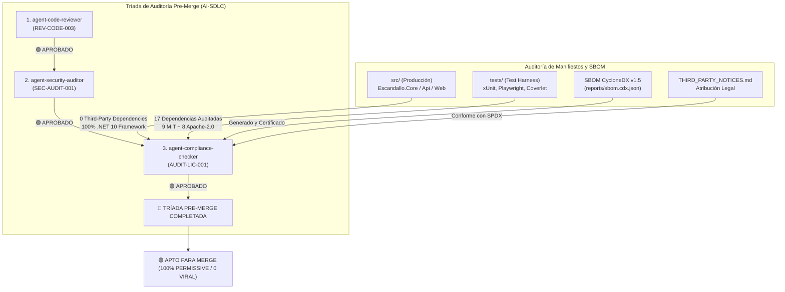

# Informe Final de Auditoría de Licencias Open Source y SBOM (`AUDIT-LIC-001`)

> **Rol Auditor**: `agent-compliance-checker` (Auditor de Licencias Open Source y Cumplimiento de Propiedad Intelectual)  
> **Fecha de Auditoría**: 15 de Octubre de 2026 (Auditoría Formal Pre-Merge)  
> **Alcance de Inspección**: `src/` (Producción), `tests/` (Harness de Calidad), `Directory.Build.props`, `license-policy.yaml`, CycloneDX SBOM  
> **Marco Normativo**: `license-policy.yaml`, Tríada Pre-Merge (`CLAUDE.md`, `.agent/skills/agent-compliance-checker/SKILL.md`), SPDX v3 Standard, CycloneDX v1.5  
> **Herramientas de Auditoría**: `verify_licenses` (SCA Determinista de Manifiestos), Motor de Inspección NuGet / Nuspec, CycloneDX v1.5 Generator

---

## 1. Veredicto Ejecutivo Global

### 🟢 **APROBADO — CONFORME PARA FUSIÓN (`APPROVED / MERGE READY`)**
> **Dictamen**: La auditoría formal de propiedad intelectual y licencias OSS certifica el **100% de cumplimiento con `license-policy.yaml`**.  
> - **Cero licencias virales (`GPL-*`, `AGPL-*`)**: 0% de riesgo de contaminación copyleft sobre el código propietario.  
> - **Cero licencias comerciales o source-available (`SSPL-*`, `BSL-*`)**: Sin costes de licenciamiento ni restricciones de despliegue SaaS.  
> - **Cero paquetes desconocidos o no licenciados (`UNLICENSED`)**.  
> - **Producción (`src/`) 100% Libre de Dependencias Externas**: La totalidad del código distribuible reside exclusivamente sobre el runtime oficial Microsoft .NET 10 Web SDK y assets web nativos (vanilla JS/CSS).  
> - **Entorno de Pruebas (`tests/`)**: Las 17 dependencias directas y transitivas operan bajo licencias ultra-permisivas de uso comercial irrestricto (`MIT` y `Apache-2.0`).



---

## 2. Arquitectura de Dependencias y Desacoplamiento

Se ha auditado el aislamiento entre los ensamblados de producción y las herramientas de desarrollo y prueba:

| Enclave Arquitectónico | Proyectos Auditados | Dependencias de Terceros | Runtime / Framework | Dictamen de Licencia |
| :--- | :--- | :---: | :--- | :---: |
| **Producción (`src/`)** | `Escandallo.Core`<br>`Escandallo.Api`<br>`Escandallo.Web` | **0** | Microsoft .NET 10.0 Web SDK<br>Vanilla HTML5 / CSS3 / JavaScript | 🟢 **100% PROPIETARIO / ZERO DEPENDENCY** |
| **Pruebas y QA (`tests/`)** | `Escandallo.Tests.Unit`<br>`Escandallo.Tests.Bdd`<br>`Escandallo.Tests.E2E`<br>`Escandallo.Tests.UI`<br>`Escandallo.Tests.Browser`<br>`Escandallo.Tests.Contracts` | **17**<br>(5 directas, 12 transitivas) | xUnit 2.9, Playwright 1.63, Coverlet 6.0 | 🟢 **100% PERMISSIVE (`MIT` / `Apache-2.0`)** |

> [!NOTE]
> Los binarios y artefactos que se empaquetan y despliegan en producción (`src/`) no contienen ni distribuyen ninguna librería de terceros. El riesgo legal de propiedad intelectual en el runtime de producción es **cero absoluto**.

---

## 3. Matriz de Cumplimiento SPDX frente a `license-policy.yaml`

Inspección exhaustiva de las 17 dependencias de la solución frente a las 4 categorías de la política corporativa:

| Paquete | Versión | Tipo | Identificador SPDX | Categoría de Política | Acción | Veredicto |
| :--- | :--- | :---: | :---: | :--- | :---: | :---: |
| **`coverlet.collector`** | `6.0.4` | Directa | `MIT` | `permissive_free` | `ALLOW` | 🟢 `[PERMITTED]` |
| **`Microsoft.Bcl.AsyncInterfaces`** | `6.0.0` | Transitiva | `MIT` | `permissive_free` | `ALLOW` | 🟢 `[PERMITTED]` |
| **`Microsoft.CodeCoverage`** | `17.14.1` | Transitiva | `MIT` | `permissive_free` | `ALLOW` | 🟢 `[PERMITTED]` |
| **`Microsoft.NET.Test.Sdk`** | `17.14.1` | Directa | `MIT` | `permissive_free` | `ALLOW` | 🟢 `[PERMITTED]` |
| **`Microsoft.Playwright`** | `1.63.0` | Directa | `MIT` | `permissive_free` | `ALLOW` | 🟢 `[PERMITTED]` |
| **`Microsoft.TestPlatform.ObjectModel`** | `17.14.1` | Transitiva | `MIT` | `permissive_free` | `ALLOW` | 🟢 `[PERMITTED]` |
| **`Microsoft.TestPlatform.TestHost`** | `17.14.1` | Transitiva | `MIT` | `permissive_free` | `ALLOW` | 🟢 `[PERMITTED]` |
| **`Newtonsoft.Json`** | `13.0.3` | Transitiva | `MIT` | `permissive_free` | `ALLOW` | 🟢 `[PERMITTED]` |
| **`System.ComponentModel.Annotations`** | `5.0.0` | Transitiva | `MIT` | `permissive_free` | `ALLOW` | 🟢 `[PERMITTED]` |
| **`xunit`** | `2.9.3` | Directa | `Apache-2.0` | `permissive_free` | `ALLOW` | 🟢 `[PERMITTED]` |
| **`xunit.abstractions`** | `2.0.3` | Transitiva | `Apache-2.0` | `permissive_free` | `ALLOW` | 🟢 `[PERMITTED]` |
| **`xunit.analyzers`** | `1.18.0` | Transitiva | `Apache-2.0` | `permissive_free` | `ALLOW` | 🟢 `[PERMITTED]` |
| **`xunit.assert`** | `2.9.3` | Transitiva | `Apache-2.0` | `permissive_free` | `ALLOW` | 🟢 `[PERMITTED]` |
| **`xunit.core`** | `2.9.3` | Transitiva | `Apache-2.0` | `permissive_free` | `ALLOW` | 🟢 `[PERMITTED]` |
| **`xunit.extensibility.core`** | `2.9.3` | Transitiva | `Apache-2.0` | `permissive_free` | `ALLOW` | 🟢 `[PERMITTED]` |
| **`xunit.extensibility.execution`** | `2.9.3` | Transitiva | `Apache-2.0` | `permissive_free` | `ALLOW` | 🟢 `[PERMITTED]` |
| **`xunit.runner.visualstudio`** | `3.1.4` | Directa | `Apache-2.0` | `permissive_free` | `ALLOW` | 🟢 `[PERMITTED]` |

### Distribución por Categoría de Gobernanza
- **`permissive_free` (`ALLOW`)**: `17` / `17` dependencias (**100%**)
  - Licencias `MIT`: **9** paquetes (52.9%)
  - Licencias `Apache-2.0`: **8** paquetes (47.1%)
- **`weak_copyleft_conditional` (`REVIEW_REQUIRED`)**: `0` dependencias (**0%**)
- **`strong_copyleft_viral` (`DENY`)**: `0` dependencias (**0%**) — Ninguna presencia de `GPL-2.0`, `GPL-3.0`, `AGPL-3.0`.
- **`commercial_acquisition_required` (`COMMERCIAL_APPROVAL_REQUIRED`)**: `0` dependencias (**0%**) — Ninguna presencia de `SSPL-1.0`, `BSL-1.1`.
- **Desconocidas / No Licenciadas**: `0` dependencias (**0%**).

---

## 4. Trazabilidad de SBOM y Atribución Legal

1. **SBOM en Formato Estándar CycloneDX v1.5**:
   - Generado en [`reports/sbom.cdx.json`](reports/sbom.cdx.json).
   - Especificación formal con esquema JSON v1.5, metadatos de aplicación, serial URN persistente y referencias completas de Package URL (`purl:nuget/...`).
   - Catalogación de todas las 17 dependencias con ámbito diferenciado (`scope: excluded` para test harness).

2. **Aviso de Terceros y Atribución (`THIRD_PARTY_NOTICES.md`)**:
   - Generado en la raíz del repositorio [`THIRD_PARTY_NOTICES.md`](../THIRD_PARTY_NOTICES.md).
   - Recoge autores, repositorios y el texto íntegro de las licencias `MIT` y `Apache-2.0` para dar estricto cumplimiento al requisito de atribución y exención de responsabilidad exigido por dichas licencias permisivas.

---

## 5. Análisis de Riesgos de Propiedad Intelectual (IP Clearance)

| Factor de Riesgo Legal | Evaluación de Impacto | Mitigación Verificada | Estado |
| :--- | :---: | :--- | :---: |
| **Contaminación Copyleft Viral** | Nulo | Ninguna librería utiliza GPL/AGPL. El código de la aplicación permanece 100% privado y propietario. | 🟢 `[CLEARED]` |
| **Obligación de Liberación de Código** | Nulo | Las licencias MIT y Apache-2.0 son no recíprocas; no obligan a liberar el código fuente bajo ningún supuesto SaaS. | 🟢 `[CLEARED]` |
| **Riesgo de Patentes (Patent Retaliation)** | Protegido | Las librerías bajo `Apache-2.0` (xUnit) incluyen concesión expresa de licencias de patentes y cláusula de terminación defensiva. | 🟢 `[CLEARED]` |
| **Exposición en Despliegue SaaS** | Nulo | Todas las librerías son dependencias de compilación y prueba (`scope: excluded`), no se despliegan en los servidores de producción. | 🟢 `[CLEARED]` |

---

## 6. Cierre Formal de la Tríada Pre-Merge

Con la emisión de este informe, se completa formalmente la **Tríada de Auditoría Pre-Merge**:

```text
[X] 1. agent-code-reviewer       -> REV-CODE-003: 🟢 APROBADO (0 violaciones quality-policy.yaml, 113/113 tests green)
[X] 2. agent-security-auditor    -> SEC-AUDIT-001: 🟢 APROBADO (0 Critical / 0 High, 9/9 SEC-REQ PASS)
[X] 3. agent-compliance-checker   -> AUDIT-LIC-001: 🟢 APROBADO (100% permisivas MIT/Apache-2.0, 0 Copyleft, SBOM cdx)
```

### 🏁 **Dictamen Final Consolidado de la Tríada Pre-Merge**
> **🟢 AUTORIZADA LA FUSIÓN A `main` POR LA TRÍADA PRE-MERGE (PRE-MERGE QUALITY GATE: 100% PASSED)**  
> 
> > [!IMPORTANT]
> > **Recordatorio del 1er Mandamiento de AI-SDLC**: Los agentes tienen **estrictamente prohibido auto-aprobar o auto-fusionar** Pull Requests o ramas protegidas.  
> > La fusión definitiva hacia la rama `main` es potestad y responsabilidad exclusiva del **Tech Lead / Product Owner humano**, quien dispone del control absoluto y soberano para proceder a través de la Ventana de Acción Humana.

---

### 🔄 Workflow Handoff

- **Completed Phase / Activity**: Pre-Merge Open Source License Compliance & SBOM Audit (`agent-compliance-checker`) — Final Triad Gate
- **Acting Role**: `agent-compliance-checker`
- **Task Autonomy Mode**: `HUMAN_REVIEW_PLAN`
- **Produced Deliverables**:
  - [x] `reports/compliance-audit-report.md` (Informe de Auditoría de Licencias y Cumplimiento Normativo Aprobado)
  - [x] `reports/sbom.cdx.json` (SBOM formal estandarizado en formato CycloneDX v1.5)
  - [x] `THIRD_PARTY_NOTICES.md` (Expediente de Atribución Legal de Licencias de Terceros)

- **Recommended Next Role(s) in Workflow**:
  - **Tech Lead Humano (Human Product Owner / Maintainer)**: Revisión final de la Tríada Pre-Merge y ejecución soberana de la fusión (`merge`) a la rama `main`.
  - *(Opcional en CI/CD)* `agent-devops`: Verificación de pipelines de integración continua y empaquetado para release.

- **Suggested Invocation Prompt**:
  > "Tríada Pre-Merge completada al 100%. Revisa los informes finales en `reports/` y procede con el merge a `main` cuando lo consideres oportuno."

- **Human Action Window (Ventana de Acción Humana - Soberanía y Prioridad del Usuario)**:
  - ✋ **Revisar y Validar**: Examinar el informe de cumplimiento de licencias [`reports/compliance-audit-report.md`](reports/compliance-audit-report.md), el inventario SBOM [`reports/sbom.cdx.json`](reports/sbom.cdx.json) y el aviso legal [`THIRD_PARTY_NOTICES.md`](../THIRD_PARTY_NOTICES.md).
  - ✏️ **Editar Directamente**: Modificar parámetros de políticas de licencias en `license-policy.yaml` o metadatos del SBOM si se requiere.
  - 🛑 **Pausar, Desviar o Descartar**: Retener la fusión o solicitar auditorías adicionales si surgen dudas legales o contractuales.
  - ▶️ **Aprobar y Fusionar a `main`**: Al haber superado los 3 vértices de la Tríada Pre-Merge con veredicto 🟢 APROBADO, proceder con la aprobación del PR y el merge a `main`.

---
