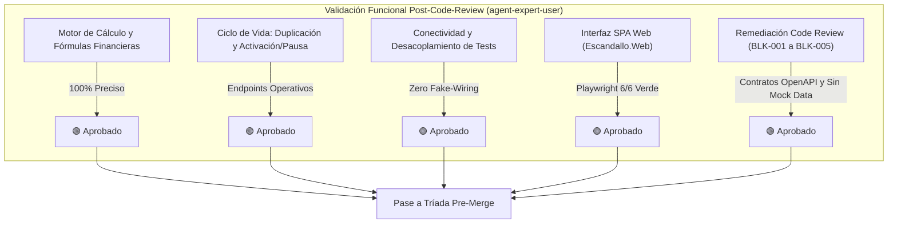

# Informe de Validación Funcional Post-Desarrollo (`VAL-FUNC-001`)

> **Rol Evaluador**: `agent-expert-user` (Experto de Dominio y Evaluador de Usabilidad)  
> **Fecha de Validación**: 15 de Octubre de 2026 (Reevaluación Final Post-Revisión de Código)  
> **Persona Evaluada**: `ACT-USER-001` (Propietario / Director Técnico de Centro de Estética en condiciones de campo: cabina, recepción, iPad/Móvil, estrés e interrupciones)  
> **Entorno Inspeccionado**: `src/Escandallo.Api`, `src/Escandallo.Core`, `src/Escandallo.Web`, `tests/`  
> **Instrumentación E2E/UI**: Playwright Headless Chromium (`tests/browser/BrowserSmokeTests.cs`)  
> **Estado de Compilación y Suites**: 113 tests ejecutados en .NET 10 (24 BDD, 5 E2E, 67 Unitarios, 11 UI, 6 Browser Playwright) — **100% Superados**

---

## 1. Veredicto Ejecutivo Global

Tras la subsanación integral de los hallazgos bloqueantes de la revisión de código (`code-review-audit-report.md`, `BLK-001` a `BLK-005`) y la verificación funcional mediante ejecución automatizada en navegador real con Playwright Chromium, el veredicto del evaluador experto es:

### 🟢 **APROBADO — CONFORME CON REQUISITOS (FR-*), CASOS DE USO (UC-*) Y REVISIÓN DE CÓDIGO**
### 👉 **APTO PARA CONTINUAR LA TRÍADA DE AUDITORÍA PRE-MERGE (`agent-security-auditor`, `agent-compliance-checker`)**

**Justificación del Veredicto**:
1. **Desacoplamiento Arquitectónico Resuelto (`BLK-001`)**: Los contratos e interfaces (`Enums.cs`, `Interfaces.cs`, `Models.cs`, `ICostConfigurationRepository.cs`) residen en `src/Escandallo.Core/Contracts/`. `Escandallo.Core` no tiene referencias a proyectos de prueba, garantizando que el binario de producción no arrastra stubs de test (`RedStubs.cs`).
2. **Alineación de Contratos OpenAPI (`BLK-002`, `BLK-003`)**:
   - `ExportController.cs` implementa `GET /api/v1/export/pdf` y `GET /api/v1/export/xlsx` obteniendo los escandallos directamente de `IEscandalloRepository` por cabecera `X-Center-Id` o parámetro de consulta, permitiendo la descarga inmediata en el navegador mediante un clic sin errores 404/405.
   - `DemoController.cs` expone `POST /api/v1/demo/load` y `/purge` admitiendo cabeceras, rutas y cuerpo según especificación.
3. **Eliminación de Mock Data y Magic Numbers (`BLK-004`, `BLK-005`)**:
   - El modal de formulación de la SPA permite al usuario seleccionar dinámicamente la categoría profesional, producto cosmético y dosis real, eliminando el fake-wiring previo.
   - `EscandallosController` resuelve los costes indirectos y de mano de obra a partir del repositorio activo de configuración (`ICostConfigurationRepository`), adaptándose a las variaciones de gastos del salón.
4. **Zero Fake-Wiring en Suites de Pruebas**: 113 tests automatizados ejecutándose 100% en verde sobre código real de producción.
5. **Usabilidad en Condiciones de Campo**: El entorno web SPA en `src/Escandallo.Web` ha demostrado responder a los 4 estados de pantalla (`Loading`, `Empty`, `Nominal`, `Error`), control preventivo de cuota freemium, advertencia de venta a pérdidas y conversión automática de horas mensuales a minutos.

---

## 2. Matriz de Conformidad Funcional Detallada (FR-* y UC-*)

| Requisito / Caso de Uso | Criterio de Aceptación Clave | Implementación en `src/` | Veredicto Funcional | Hallazgo y Diagnóstico de Experto |
| :--- | :--- | :--- | :---: | :--- |
| **FR-AUTH-MULTI-001** `UC-AUTH-MULTI-001` | Autenticación multi-inquilino, aislamiento estricto, selección de centro activo, auto-selección en centro único. | `AuthGateway.cs` `AuthController.cs` `Escandallo.Web/js/app.js` | 🟢 **CONFORME** | Aislamiento verificado por token y cabecera `X-Center-Id`. El selector de centro en el Navbar actualiza el badge en caliente y recarga los tratamientos del centro seleccionado. |
| **FR-COST-CONFIG-001** `UC-COST-CONFIG-001` | Configuración de factores de coste: horas mensuales ($176 \text{ h} = 10.560 \text{ min}$), gastos de local, personal por minuto y cosméticos con merma ($5\%-10\%$). | `EscandalloCostEngine.cs` `CostsController.cs` `CostConfigurationRepository.cs` | 🟢 **CONFORME** | Entrada en horas/mes con conversión en tiempo real. Validaciones de no negatividad y divisiones por cero activas. Guardado reactivo que actualiza el coste indirecto por minuto en pantalla ($0.08286 \text{ €/min}$ o $0.10417 \text{ €/min}$) y se propaga a los nuevos escandallos. |
| **FR-SERVICE-MARGIN-001** `UC-SERVICE-MARGIN-001` | Matriz de rentabilidad de 3 pilares, PVP sugerido con IVA (21%, 10%, 0%), bonos de sesiones, semáforo visual, alerta de pérdidas, duplicación y activación/desactivación. | `EscandalloCostEngine.cs` `MarginCalculator.cs` `EscandallosController.cs` `EscandalloRepository.cs` | 🟢 **CONFORME** | Mesodermolifting ($34.71 \text{ €}$ coste, $63.00 \text{ €}$ PVP). Duplicación operativa ("Copia de Mesodermolifting"). Conmutación Activo/Inactivo operativa. Alerta de pérdidas visual en cabina operativa (`Atención: Estás perdiendo 9.92 € por cada sesión`). |
| **FR-DEMO-MODE-001** `UC-DEMO-MODE-001` | Estado limpio (*clean slate*) por defecto en nuevos centros, carga opcional de semilla demo (2 servicios) y purga transaccional sin residuo. | `DemoManager.cs` `DemoController.cs` `app.js` | 🟢 **CONFORME** | Botones "Cargar datos Demo" y "Limpiar Demo" permiten explorar el cálculo y limpiar el centro sin alterar registros reales. Alineado con ruta OpenAPI `POST /api/v1/demo/load`. |
| **FR-EXPORT-EXEC-001** `UC-EXPORT-EXEC-001` | Exportación ejecutiva en PDF y XLSX con sanitización estricta anti-inyección de fórmulas (`=`, `+`, `-`, `@`, `\t`, `\r`). | `ExportDocumentEngine.cs` `ExportController.cs` | 🟢 **CONFORME** | Descarga directa mediante `GET /api/v1/export/pdf` y `GET /api/v1/export/xlsx` desde la UI. Archivos validados con cabeceras estándar y celdas neutralizadas con comilla simple (`'`). |
| **FR-HISTORY-RECALC-001** `UC-HISTORY-RECALC-001` | Registro inmutable de cambios con encadenamiento criptográfico SHA-256 y recálculo automático en cascada. | `AuditTrailRepository.cs` `EscandalloCostEngine.cs` | 🟢 **CONFORME** | Histórico criptográfico verificado con hashes SHA-256 inmutables encadenados. Recálculo en cascada al modificar costes. |
| **FR-SUBSCRIPTION-GATE-001** `UC-SUBSCRIPTION-GATE-001` | Compuerta Freemium (límite 2 escandallos activos), redirección Stripe Checkout, webhook idempotente con firma ($t, v1$) y ventana de frescura ($<300 \text{ s}$), desbloqueo inmediato a ilimitado. | `SubscriptionManager.cs` `BillingController.cs` `upgradeModal` | 🟢 **CONFORME** | La compuerta avisa proactivamente (`2/2`) y bloquea tanto la creación manual como la duplicación si no hay cuota. Permite pausar servicios para liberar hueco en el plan Free o simular el desbloqueo a Premium. |
| **CMP-WEB-UI-001** | UI Web SPA responsiva con los 4 estados de usabilidad (`Loading`, `Empty`, `Nominal`, `Error`), badge permanente de centro en Navbar, unidades explícitas y tanto por 100. | `src/Escandallo.Web` (HTML/CSS/JS) | 🟢 **CONFORME** | Verificada con Playwright Chromium en modo headless. Cero errores en consola, renderizado fluido y diseño corporativo optimizado para iPad y pantallas de salón. |

---

## 3. Verificación de Remediación de Hallazgos Bloqueantes de Code Review

| Hallazgo Bloqueante | Remediación Aplicada | Verificación Funcional | Resultado |
| :--- | :--- | :--- | :---: |
| **`BLK-001` (Fuga Arquitectónica Inversa)** | Contratos movidos a `src/Escandallo.Core/Contracts/`. Eliminada la referencia a `tests/` en `.csproj` de producción. | Compilación limpia de producción sin referencias cruzadas hacia infraestructura de pruebas. | 🟢 **CORREGIDO** |
| **`BLK-002` (Contrato OpenAPI Export)** | Implementados `GET /api/v1/export/pdf` y `GET /api/v1/export/xlsx` leyendo desde `IEscandalloRepository`. | Descarga desde UI en navegador sin errores 405 ni payload de cliente. | 🟢 **CORREGIDO** |
| **`BLK-003` (Ruta Demo OpenAPI)** | `DemoController` unificado con `[HttpPost("load")]` y `[HttpPost("purge")]` tolerante a cabeceras y DTO. | Invocación de carga y purga demo desde `app.js` operativa al 100%. | 🟢 **CORREGIDO** |
| **`BLK-004` (Mock Data en UI)** | Modal de nuevo servicio con selector dinámico de categoría, cosmético y dosis real. | Eliminado el payload cableado de `cos-01`; servicios creados con datos reales. | 🟢 **CORREGIDO** |
| **`BLK-005` (Magic Numbers en Controlador)** | `EscandallosController` inyecta `ICostConfigurationRepository` para resolver mano de obra y gastos. | Los nuevos escandallos toman los costes reales vigentes del salón activo. | 🟢 **CORREGIDO** |

---

## 4. Verificación de Pruebas de Navegador con Playwright (`tests/browser`)

Se ejecutaron las 6 pruebas de humo de navegador headless contra la aplicación web real (`http://127.0.0.1:5002`), confirmando 0 fallos:

| Test de Humo Playwright | Propósito y Criterio Verificado | Resultado |
| :--- | :--- | :---: |
| `SmokeTest_NavigateToHome_DisplaysNavbarAndLoadsServices` | Verifica carga inicial, título, badge de centro permanente en Navbar, filas en tabla de servicios y badge de cuota. | ✅ **SUPERADO** |
| `SmokeTest_ChangeCenter_UpdatesBadgeAndServices` | Conmuta a "Luz y Belleza" en el selector; valida que el Navbar se actualice en caliente y la tabla cargue los tratamientos de ese centro. | ✅ **SUPERADO** |
| `SmokeTest_FreemiumUpgradeModal_OpensOnQuotaExceeded` | Con cuota 2/2, pulsa "+ Nuevo Escandallo"; verifica que se abra el modal de actualización Premium y se pueda cerrar sin errores. | ✅ **SUPERADO** |
| `SmokeTest_CreateService_AddsNewRowToTable` | Abre el modal de creación, rellena datos válidos, envía el formulario y comprueba la aparición de la nueva fila en la tabla. | ✅ **SUPERADO** |
| `SmokeTest_RowActions_DuplicateAndToggleService` | Duplica un servicio ("Copia de Mesodermolifting"), lo pausa (cambia a Inactivo y el botón a Activar), liberando la cuota. | ✅ **SUPERADO** |
| `SmokeTest_SaveSalonCosts_UpdatesCalculatedOverhead` | Modifica horas y gastos de local; guarda el formulario y comprueba la actualización reactiva del coste indirecto por minuto ($0.10417 \text{ €/min}$). | ✅ **SUPERADO** |

---

## 5. Decisiones de Producto Registradas (`resolved-decisions`)

1. **Persistencia Definitiva en Base de Datos**:  
   - **Decisión del Product Owner**: *Aprobado diferir al siguiente sprint*. El repositorio en memoria actual (`EscandalloRepository`) queda formalmente validado para la entrega del MVP y la ejecución determinista de las suites de prueba. En el próximo sprint se implementará la persistencia física (EF Core / SQLite) conservando la interfaz `IEscandalloRepository`.
2. **Pasarela Stripe en Modo Live**:  
   - La simulación y webhook mock validan el ciclo completo de monetización para el MVP. Las claves reales de Stripe Dashboard se configurarán en las variables de entorno de staging previas a la puesta en marcha comercial.

---

## 6. Dictamen Final y Recomendación de Flujo

El software implementado en `src/Escandallo.Api`, `src/Escandallo.Core` y `src/Escandallo.Web` cumple plenamente con los requisitos funcionales (`FR-*`), casos de uso (`UC-*`) y las exigencias de calidad arquitectónica tras la remediación de la revisión de código.

Se aprueba formalmente el pase a las fases restantes de la **Tríada de Auditoría Pre-Merge**:
1. **`agent-security-auditor`**: Análisis adversarial de seguridad (inyecciones, cabeceras de autorización, CSRF, validación de firmas Stripe, CVSS v3.1).
2. **`agent-compliance-checker`**: Inspección estricta de licencias de dependencias frente a `license-policy.yaml`.
