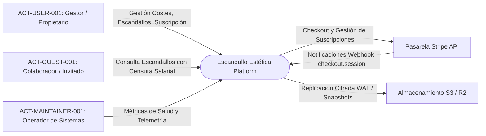
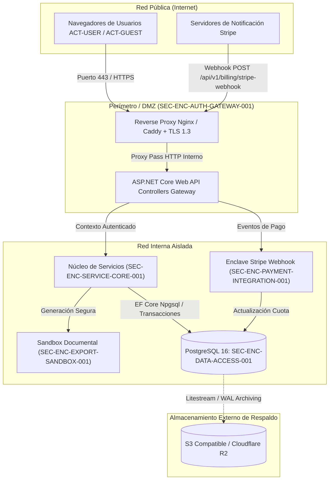

# 03. Context and Scope (arc42 Sec. 3 / NAF Operational)

## 1. Business Context
Define las fronteras conceptuales y operativas del sistema **Escandallo Estética** con respecto a sus actores humanos y servicios externos integrados.

### 1.1 Diagrama de Contexto de Negocio

### 1.2 Intercambios de Información Operativa (`OIE-*`)
| Exchange ID | Origen / Destino | Carga Útil / Mensaje | Protocolo / Canal | Formato |
| :--- | :--- | :--- | :--- | :--- |
| `OIE-WEB-CLIENT-001` | Cliente Web ➔ Sistema | Peticiones CRUD costes, escandallos y reportes | HTTPS (TLS 1.3) / REST | JSON (OpenAPI v3.1) |
| `OIE-STRIPE-WEBHOOK-002` | Stripe ➔ Sistema | Eventos de pago (`checkout.session.completed`) | HTTPS / POST | JSON firmado HMAC-SHA256 |
| `OIE-S3-BACKUP-003` | Sistema ➔ S3 Storage | Volcados lógicos de BD y fragmentos WAL | HTTPS / S3 API | Blobs binarios cifrados AES-256 |
| `OIE-DOC-EXPORT-004` | Sistema ➔ Gestor | Informes ejecutivos consolidados de escandallos | HTTPS / GET Stream | Binario (PDF / XLSX) |

---

## 2. Technical Context and Perimeter Infrastructure
Define los límites físicos y lógicos de la infraestructura de red, zonas de seguridad y componentes de enrutamiento.

### 2.1 Diagrama de Contexto Técnico

---

## 3. Historial de Revisiones

| Versión | Fecha | Autor / Agente | Descripción del Cambio | Referencia |
| :--- | :--- | :--- | :--- | :--- |
| **1.0.0** | 2026-10-15 | `agent-system-architect` | Definición de contexto de negocio y contexto técnico arc42 / NAF | CHG-ARCH-001 |
