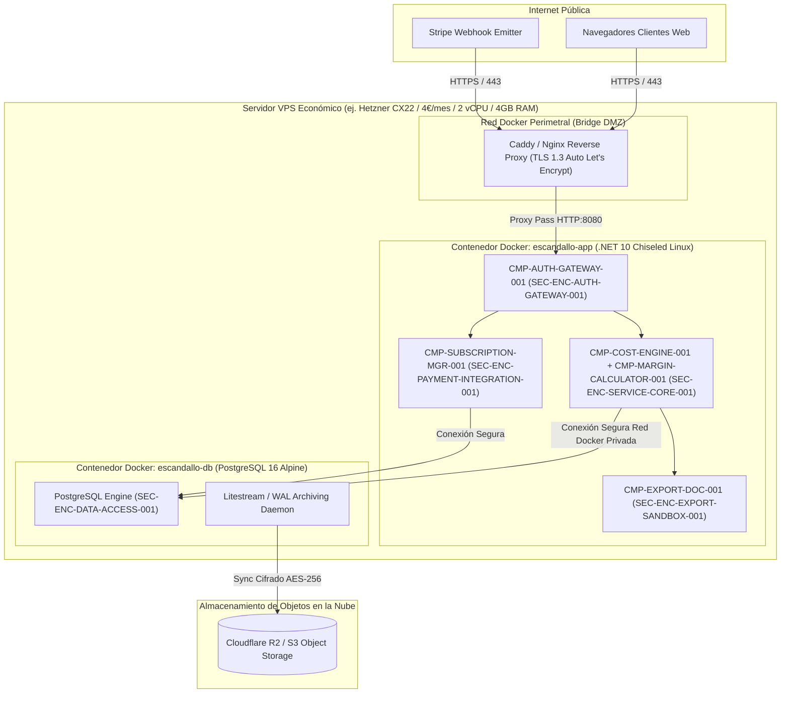

# 07. Deployment View (arc42 Sec. 7 / NAF Resource Deployment)

## 1. Topología de Infraestructura y Enclaves de Red
Mapea la distribución de componentes sobre recursos de cómputo en la nube, optimizada para satisfacer `QR-DEPLOY-COST-001` (coste mensual $< 10-15$ €) y `QR-AVAILABILITY-001` (alta disponibilidad 24/7):

---

## 2. Inventario de Recursos y Nodos de Ejecución (`RES-*`)

| Resource ID | Tipo de Recurso | Enclave Mapeado | Capacidad / Límite Asignado | Componentes Desplegados |
| :--- | :--- | :--- | :--- | :--- |
| `RES-NODE-VPS-01` | Host Virtual (Hetzner CX22 o similar) | Todos (Host) | 2 vCPU / 4 GB RAM / 40 GB NVMe | Docker Daemon, Reverse Proxy, volúmenes locales |
| `RES-CONTAINER-APP-01`| Contenedor Linux Chiseled | `SEC-ENC-AUTH-GATEWAY-001`, `SEC-ENC-SERVICE-CORE-001`, `SEC-ENC-EXPORT-SANDBOX-001`, `SEC-ENC-PAYMENT-INTEGRATION-001` | 1 vCPU / Límite RAM: 256 MB (Consumo reposo < 150 MB) | Backend .NET 10 Web API Controllers, Web Assets estáticos SPA |
| `RES-CONTAINER-DB-01` | Contenedor PostgreSQL 16 | `SEC-ENC-DATA-ACCESS-001` | 1 vCPU / Límite RAM: 512 MB | Motor PostgreSQL, catálogo, auditoría histórica |
| `RES-STORAGE-S3-01`   | Bucket S3 (Cloudflare R2) | DR / Continuidad | Capacidad elástica (Pago por uso < 1 €/mes) | Volcados lógicos diarios y fragmentos WAL continuos |

---

## 3. Políticas de Red, Aislamiento y Resiliencia
- **Aislamiento de Red Docker**: La base de datos PostgreSQL no expone ningún puerto hacia el host ni hacia la red pública; únicamente es accesible a través de la red interna privada de Docker (`escandallo-internal-net`).
- **Supervisión y Recuperación Automática**: Contenedores configurados con `restart: unless-stopped` y Docker Healthcheck invocando los endpoints `/healthz` de ASP.NET Core cada 30 segundos.
- **Backups Continuos**: El proceso archivador replica continuamente los registros Write-Ahead Logging (WAL) en Cloudflare R2 sin costes de salida de datos (Zero Egress Fees), satisfaciendo `QR-DR-BACKUP-001` (RPO $\le$ 1h, RTO $\le$ 2h).

---

## 4. Historial de Revisiones

| Versión | Fecha | Autor / Agente | Descripción del Cambio | Referencia |
| :--- | :--- | :--- | :--- | :--- |
| **1.0.0** | 2026-10-15 | `agent-system-architect` | Definición de vista de despliegue e infraestructura en contenedor arc42 / NAF | CHG-ARCH-001 |
