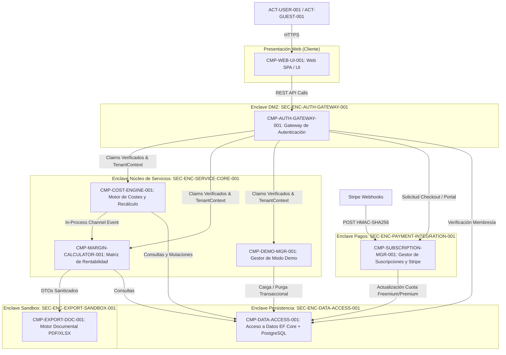

# 05. Building Blocks View: Level 1 Whitebox (arc42 Sec. 5 / NAF Services & Systems)

## 1. Overall System Decomposition (Level 1)
Descompone el sistema **Escandallo Estética** en subsistemas modulares, contenedores de ejecución y contextos delimitados (Bounded Contexts) bajo el modelo de arquitectura limpia y enclaves seguros.

### 1.1 Diagrama Whitebox Nivel 1

---

## 2. Bounded Contexts and Root Components Catalog

| Contexto Delimitado | Componente ID | Tipo Implementación | Enclave Asociado | Responsabilidad Primaria |
| :--- | :--- | :---: | :--- | :--- |
| **Identidad y Acceso** | `CMP-AUTH-GATEWAY-001` | `service` | `SEC-ENC-AUTH-GATEWAY-001` | Validación de credenciales, emisión de JWT, limitación de tasa perimetral y comprobación de membresía multicentro. |
| **Cálculo de Costes** | `CMP-COST-ENGINE-001` | `service` | `SEC-ENC-SERVICE-CORE-001` | CRUD de factores de coste (personal, local, consumibles) y motor asíncrono de recálculo en cascada con *debouncing*. |
| **Cálculo de Costes** | `CMP-MARGIN-CALCULATOR-001` | `service` | `SEC-ENC-SERVICE-CORE-001` | Evaluación de fórmulas de escandallo, cálculo de márgenes con IVA y asignación de código semáforo visual (rojo/amarillo/verde). |
| **Facturación** | `CMP-SUBSCRIPTION-MGR-001` | `service` | `SEC-ENC-PAYMENT-INTEGRATION-001` | Control atómico de cuota freemium (máx 2 escandallos) y verificación criptográfica de webhooks Stripe con deduplicación. |
| **Exportación** | `CMP-EXPORT-DOC-001` | `service` | `SEC-ENC-EXPORT-SANDBOX-001` | Generación de informes PDF y XLSX en sandbox estricto sin red y sanitización anti-formula injection. |
| **Gestión de Entorno** | `CMP-DEMO-MGR-001` | `service` | `SEC-ENC-SERVICE-CORE-001` | Inicialización limpia de centros y carga/purga transaccional de datos de demostración con discriminador `is_demo`. |
| **Persistencia** | `CMP-DATA-ACCESS-001` | `composite` | `SEC-ENC-DATA-ACCESS-001` | Aislamiento lógico multi-inquilino mediante EF Core Global Query Filters y registro inmutable append-only de auditoría. |
| **Presentación** | `CMP-WEB-UI-001` | `function` | `SEC-ENC-AUTH-GATEWAY-001` | Interfaz gráfica web responsiva con selector de centros, semáforos visuales interactivos y soporte de censura para invitados. |

---

## 3. Recursive Decomposition into Sub-Levels
Cada subsistema catalogado dispone de su especificación individual Nivel 2 (`CMP-*.md`) alineada con las plantillas oficiales del marco AI-SDLC.

---

## 4. Historial de Revisiones

| Versión | Fecha | Autor / Agente | Descripción del Cambio | Referencia |
| :--- | :--- | :--- | :--- | :--- |
| **1.0.0** | 2026-10-15 | `agent-system-architect` | Definición de vista de bloques funcionales Nivel 1 Whitebox arc42 / NAF | CHG-ARCH-001 |
