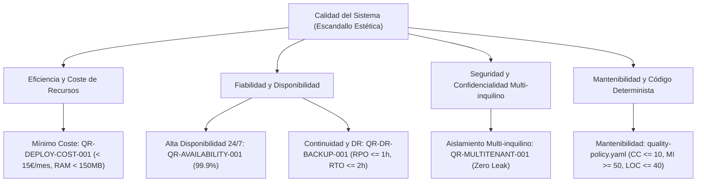

# 10. Quality Requirements (arc42 Sec. 10 / NAF Quality)

## 1. Árbol de Calidad (Quality Tree)
Estructura jerárquica de los atributos y metas de calidad clave del sistema según la norma ISO/IEC 25010 y las políticas del marco AI-SDLC:

---

## 2. Escenarios de Calidad Evaluables (Quality Scenarios)
Definición de escenarios concretos con estímulo, entorno, respuesta y métrica objetiva:

| Requisito ID | Atributo ISO | Estímulo y Entorno | Respuesta del Sistema | Medida Objetiva |
| :--- | :--- | :--- | :--- | :--- |
| `QR-DEPLOY-COST-001` | Eficiencia de Recursos | Backend en reposo o carga moderada en VPS Linux modesto | Mínima huella de proceso .NET 10 y pooling de conexiones | Memoria RAM $< 150$ MB; coste servidor $< 15$ €/mes |
| `QR-AVAILABILITY-001` | Disponibilidad | Caída inesperada del hilo de aplicación o reinicio de host | Docker `restart: unless-stopped` + Health Checks `/healthz` | Disponibilidad anual $\ge 99.9\%$ (Downtime $< 8.7$ h/año) |
| `QR-MULTITENANT-001` | Confidencialidad | Petición HTTP maliciosa intentando leer ID de centro o inquilino ajeno | Interceptación automática en EF Core Global Query Filter | Fuga de datos entre centros $= 0$ (Retorno 404/403) |
| `QR-DR-BACKUP-001` | Recuperabilidad | Caída catastrófica del servidor VPS principal | Despliegue de nuevo host + restauración de snapshot y WAL desde S3 | RPO $\le 1$ hora; RTO $\le 2$ horas verificable |
| `quality-policy.yaml`| Mantenibilidad | Implementación o refactorización de lógica de escandallo | Análisis estático automatizado en Pre-Flight | Complejidad Ciclomática $\le 10$, Líneas por función $\le 40$ |

---

## 3. Historial de Revisiones

| Versión | Fecha | Autor / Agente | Descripción del Cambio | Referencia |
| :--- | :--- | :--- | :--- | :--- |
| **1.0.0** | 2026-10-15 | `agent-system-architect` | Definición de árbol de calidad y escenarios evaluables arc42 / NAF | CHG-ARCH-001 |
