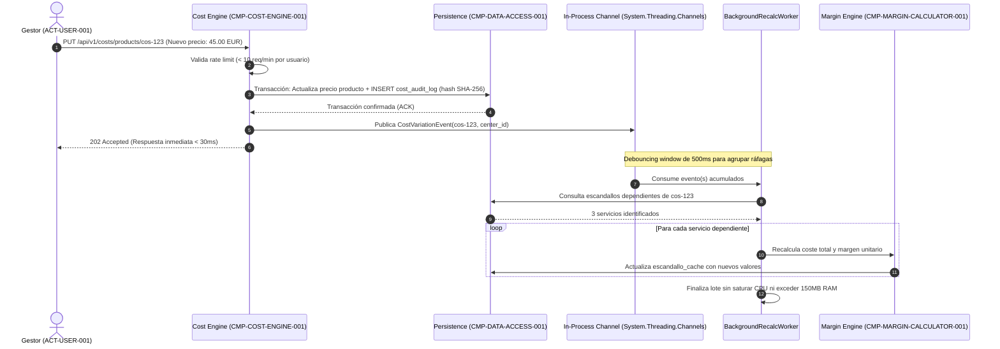
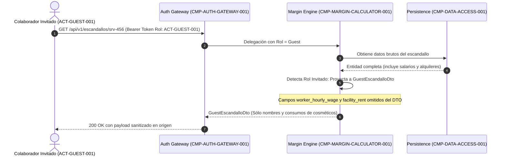
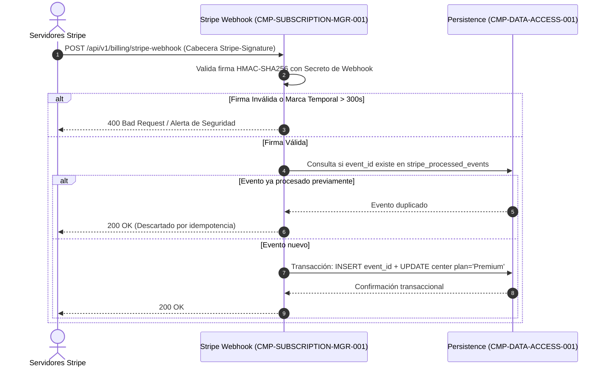
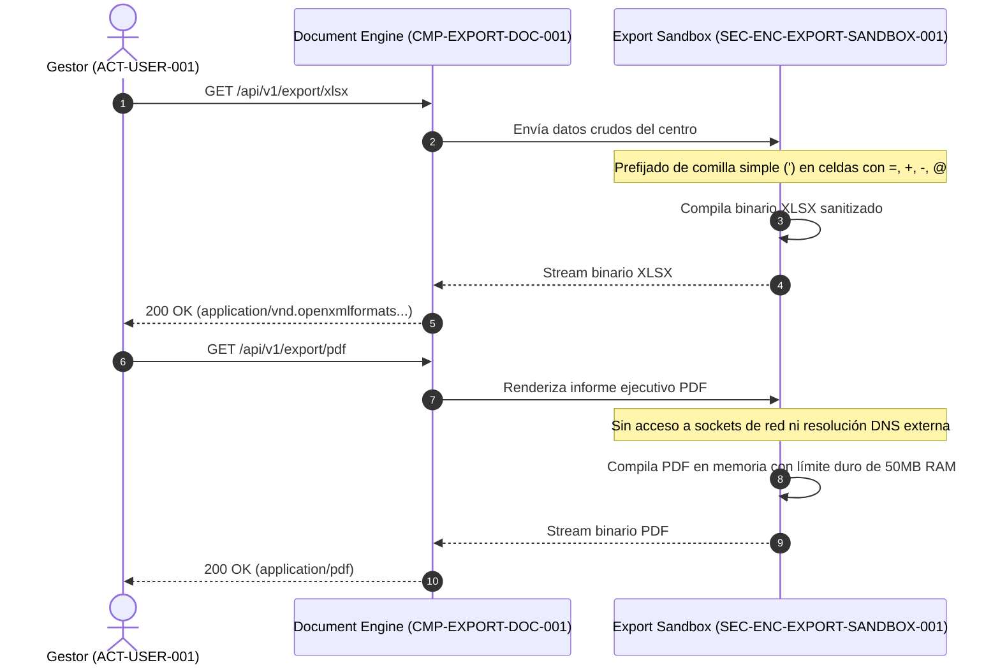
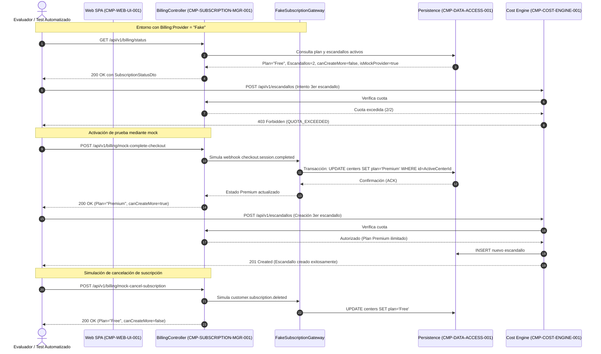

# 06. Runtime View (arc42 Sec. 6 / NAF Behaviour)

## 1. Escenario Nominal: Consulta y Cálculo de Escandallos (`SEQ-NOMINAL-001`)
Orquestación estándar de una petición de consulta de escandallos por un usuario gestor (`ACT-USER-001`):

```mermaid
sequenceDiagram
    autonumber
    actor User as Gestor (ACT-USER-001)
    participant UI as Web SPA (CMP-WEB-UI-001)
    participant Gateway as Auth Gateway (CMP-AUTH-GATEWAY-001)
    participant Core as Margin Engine (CMP-MARGIN-CALCULATOR-001)
    participant DB as Persistence (CMP-DATA-ACCESS-001)

    User->>UI: Navega a matriz de servicios del centro activo
    UI->>Gateway: GET /api/v1/escandallos (Bearer JWT, X-Center-Id)
    Gateway->>Gateway: Valida firma JWT y pertenencia de CenterId a TenantId
    Gateway->>Core: Invocación con TenantContext(tenant_id, center_id, role)
    Core->>DB: Consulta servicios con EF Core Global Query Filters
    DB-->>Core: Lista de tratamientos y factores de coste asociados
    Core->>Core: Evalúa costes, IVA y margen neto; asigna semáforo verde/amarillo/rojo
    Core-->>Gateway: CompleteEscandalloDto[] (sin censura para Gestor)
    Gateway-->>UI: 200 OK con payload JSON completo
    UI-->>User: Renderiza tabla con semáforos de rentabilidad
```

---

## 2. Escenario Asíncrono: Variación de Precio y Recálculo en Cascada (`SEQ-RECALC-002`)
Modificación de un precio de compra cosmético con auditoría criptográfica y propagación desacoplada con debouncing (`FR-HISTORY-RECALC-001`, `SEC-REQ-RATE-RECALC-THROTTLE-001`):



---

## 3. Escenario de Seguridad: Censura en Origen para Invitados (`SEQ-GUEST-CENSOR-003`)
Mitigación de fuga de salarios y alquileres frente a colaboradores invitados (`ACT-GUEST-001`, `BR-GUEST-CENSOR-001`, `SEC-REQ-DATA-CENSOR-GUEST-001`):



---

## 4. Escenario de Integración: Webhook de Stripe e Idempotencia (`SEQ-STRIPE-WEBHOOK-004`)
Procesamiento seguro de eventos de suscripción procedentes de Stripe (`FR-SUBSCRIPTION-GATE-001`, `SEC-REQ-STRIPE-SIGNATURE-001`):



---

## 5. Escenario de Aislamiento Documental: Sandbox PDF y XLSX (`SEQ-EXPORT-SANDBOX-005`)
Prevención de Formula Injection en hojas de cálculo y SSRF en generación de PDFs (`FR-EXPORT-EXEC-001`, `SEC-REQ-EXPORT-SANITIZATION-001`):



---

## 6. Escenario de Pruebas: Ciclo de Vida de Suscripción con Proveedor Fake/Mock (`SEQ-MOCK-SUBSCRIPTION-006`)
Flujo hermético para desarrolladores, evaluadores y tests automatizados (CI) para validar el desbloqueo de la cuota freemium sin depender de cuentas ni servidores de Stripe (`ADR-007`):



---

## 7. Historial de Revisiones

| Versión | Fecha | Autor / Agente | Descripción del Cambio | Referencia |
| :--- | :--- | :--- | :--- | :--- |
| **1.0.0** | 2026-10-15 | `agent-system-architect` | Definición de vista dinámica y escenarios nominales y de seguridad arc42 | CHG-ARCH-001 |
| **1.1.0** | 2026-10-15 | `agent-system-architect` | Adición de escenario SEQ-MOCK-SUBSCRIPTION-006 con proveedor Fake/Mock | CHG-ARCH-001 |
