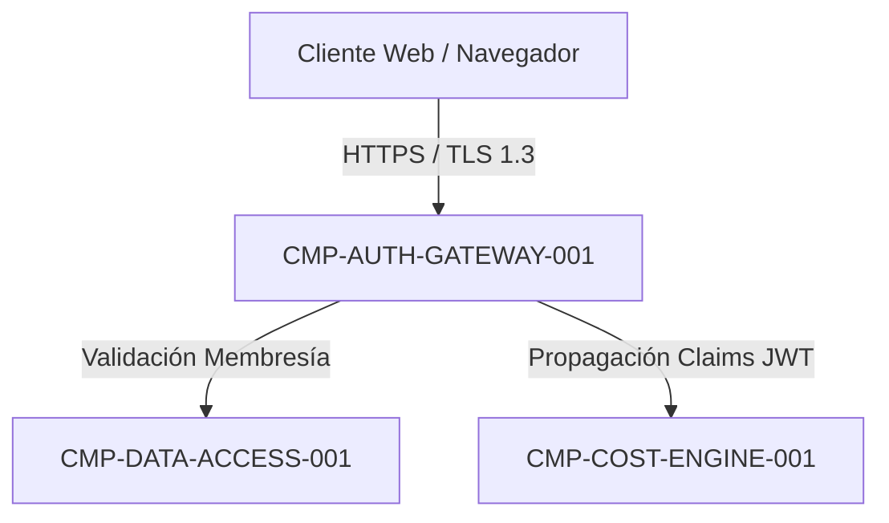

# CMP-AUTH-GATEWAY-001: Gateway Perimetral de Autenticación y Control de Acceso

## 1. Propósito, Responsabilidad y Contexto Delimitado
El componente gestiona el ciclo de vida de autenticación de usuarios, emisión y validación criptográfica de tokens JWT, control de intentos fallidos (rate limiting perimetral) y verificación estricta de la selección de centro activo (`CenterId`) verificando que pertenezca inequívocamente al `TenantId` del usuario autenticado.

## 2. Diagrama Estructural y de Conectividad

## 3. Contratos de Interfaz y Políticas de Ejecución
- **Mecanismo de Ejecución**: Middleware perimetral ASP.NET Core (.NET 10) alojado en `SEC-ENC-AUTH-GATEWAY-001`.
- **Tolerancia a Fallos y Rendimiento**: Latencia p95 < 20 ms en validación de tokens en memoria; throttling a máx 5 intentos de login erróneos por minuto por IP/usuario.

---

## 4. Historial de Revisiones

| Versión | Fecha | Autor / Agente | Descripción del Cambio | Referencia |
| :--- | :--- | :--- | :--- | :--- |
| **1.0.0** | 2026-10-15 | `agent-system-architect` | Definición de arquitectura de componente perimetral de autenticación | CHG-ARCH-001 |
