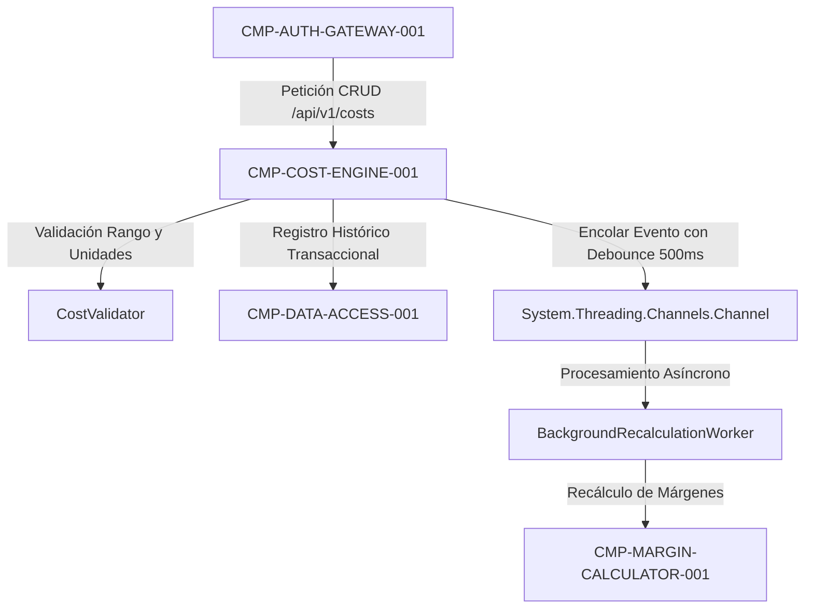

# CMP-COST-ENGINE-001: Motor de Factores de Coste y Recálculo en Cascada

## 1. Propósito, Responsabilidad y Contexto Delimitado
Responsable de la administración granular (CRUD) de los factores de coste base por centro:
1. Minutos mensuales de apertura del salón (base 10.560 min/mes).
2. Gastos generales mensuales (alquiler, consumos, servicios, seguros).
3. Salarios de personal y costes brutos empresa mensuales.
4. Catálogo de productos cosméticos y consumibles (capacidad, precio de compra y porcentaje de merma).

Gestiona asimismo el recálculo automático en cascada: ante cualquier modificación de precios de consumibles o tarifas horarias, identifica los escandallos dependientes y encola la actualización asíncrona mediante `System.Threading.Channels` aplicando *debouncing* de 500 ms y limitación de tasa (máximo 10 mutaciones por minuto) para neutralizar sobrecargas de CPU y mantener el consumo de RAM inferior a 150 MB (`QR-DEPLOY-COST-001`, `SEC-REQ-RATE-RECALC-THROTTLE-001`).

## 2. Diagrama Estructural y de Conectividad (arc42 Sec. 5 / NAF v4)

## 3. Contratos de Interfaz y Políticas de Ejecución
- **Mecanismo de Ejecución**: Servicio de aplicación en ASP.NET Core (.NET 10) con trabajador en segundo plano `IHostedService` apoyado en canal desacoplado `Channel<CostVariationEvent>`.
- **Tolerancia a Fallos y Rendimiento**: Política de tasa con Token Bucket perimetral; capacidad acotada en canal en memoria (BoundedChannel de 1.000 eventos con `BoundedChannelFullMode.Wait`); recálculos por lotes sin saturar el pool de conexiones de PostgreSQL.

---

## 4. Historial de Revisiones

| Versión | Fecha | Autor / Agente | Descripción del Cambio | Referencia |
| :--- | :--- | :--- | :--- | :--- |
| **1.0.0** | 2026-10-15 | `agent-system-architect` | Definición de componente de gestión de factores de coste y recálculo | CHG-ARCH-001 |
