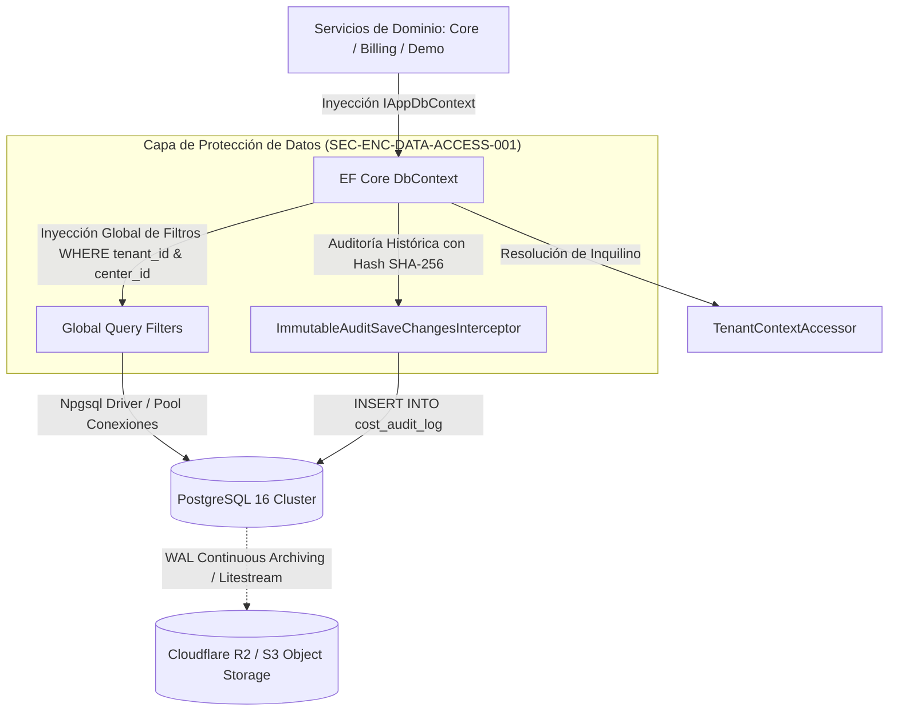

# CMP-DATA-ACCESS-001: Capa de Acceso a Datos y Persistencia Multi-inquilino

## 1. Propósito, Responsabilidad y Contexto Delimitado
Proporciona el motor de persistencia relacional unificado en PostgreSQL y la capa de mapeo objeto-relacional mediante Entity Framework Core (.NET 10), garantizando el cumplimiento estricto de las garantías de seguridad y calidad:
1. **Aislamiento Multi-inquilino Automático (`QR-MULTITENANT-001`, `SEC-REQ-AUTHZ-TENANT-FILTER-001`)**:
   - Todas las entidades de negocio implementan `ITenantScopedEntity` (`tenant_id`, `center_id`).
   - Aplicación obligatoria de *EF Core Global Query Filters* que filtran transparentemente por el inquilino y centro resueltos en el contexto de la sesión HTTP (`TenantContext`).
   - Interceptor de guardado (`SaveChangesInterceptor`) que inyecta automáticamente los identificadores de pertenencia y valida que ninguna consulta intente acceder a registros ajenos (anti-BOLA / IDOR).
2. **Registro de Auditoría Inmutable Criptográficamente Sellado (`SEC-REQ-AUDIT-IMMUTABLE-001`)**:
   - Tabla `cost_audit_log` estrictamente *append-only*.
   - Encadenamiento criptográfico con hash SHA-256 del registro anterior para garantizar el no repudio e impedir la manipulación silenciosa de costes.
   - Prohibición de permisos `UPDATE` y `DELETE` para el usuario de base de datos de la aplicación.
3. **Continuidad de Negocio y Recuperación ante Desastres (`QR-DR-BACKUP-001`)**:
   - Motor de persistencia PostgreSQL 16 configurado con Write-Ahead Logging (WAL) continuo hacia almacenamiento S3 compatible (Cloudflare R2).
   - Volcados lógicos diarios cifrados con AES-256 (`pg_dump`).
   - RPO $\le$ 1 hora y RTO $\le$ 2 horas verificable mediante procedimientos automatizados.

## 2. Diagrama Estructural y de Conectividad (arc42 Sec. 5 / NAF v4)

## 3. Contratos de Interfaz y Políticas de Ejecución
- **Mecanismo de Ejecución**: Módulo `Infrastructure.Persistence` en ensamblado .NET 10 con conexión gestionada vía pool `Npgsql` y transacciones gestionadas con aislamiento `Read Committed` por defecto y `Repeatable Read` / `Serializable` para verificaciones de cuota.
- **Tolerancia a Fallos y Rendimiento**: Consultas indexadas por `(tenant_id, center_id)`; consumo mínimo de conexiones (pool máximo de 20 conexiones en VPS económico); soporte de migraciones automáticas idempotentes con EF Core Migrations.

---

## 4. Historial de Revisiones

| Versión | Fecha | Autor / Agente | Descripción del Cambio | Referencia |
| :--- | :--- | :--- | :--- | :--- |
| **1.0.0** | 2026-10-15 | `agent-system-architect` | Definición de capa de persistencia multi-inquilino, auditoría criptográfica y DR | CHG-ARCH-001 |
