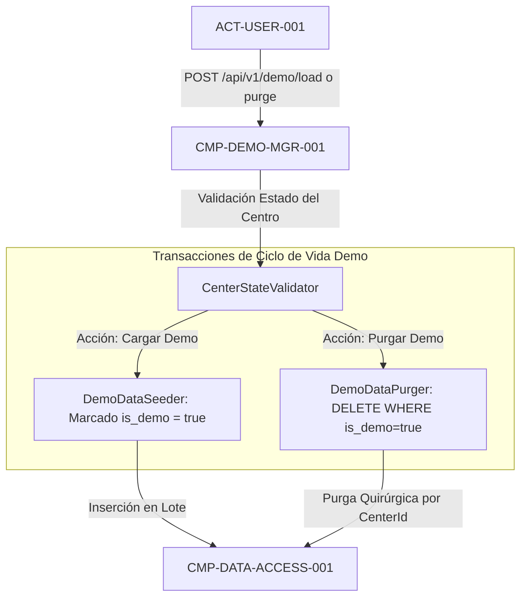

# CMP-DEMO-MGR-001: Gestor de Aislamiento y Ciclo de Vida de Modo Demo

## 1. Propósito, Responsabilidad y Contexto Delimitado
Gestiona la separación estricta entre la contabilidad real de los salones de belleza y los conjuntos de datos demostrativos (`UC-DEMO-MODE-001`, `BR-DEMO-DATA-001`):
1. **Inicialización Limpia por Defecto (`FR-DEMO-MODE-001`)**: Todo centro recién creado se inicializa en blanco (0 trabajadores, 0 gastos generales, 0 cosméticos y 0 escandallos).
2. **Carga Opt-In con Etiquetado Inmutable (`SEC-REQ-DEMO-ISOLATION-001`)**: Permite únicamente bajo petición voluntaria del gestor la carga del catálogo representativo de ejemplo (cosméticos como "Cleasing Milk", gastos de apertura de 10.560 min/mes y servicios como "Mesodermolifting"). Todos los registros se etiquetan forzosamente con `is_demo = true`.
3. **Bloqueo de Contaminación Cruzada**: Bloquea la carga de datos demo si el centro ya contiene registros reales (`is_demo = false`) a menos que medie confirmación explícita.
4. **Purga Quirúrgica Transaccional (`SEC-REQ-DEMO-ISOLATION-001`)**: Ejecuta el borrado atómico en base de datos filtrando estrictamente por `is_demo = true` y `center_id = @ActiveCenterId`, garantizando que la totalidad de los datos ficticios se eliminen sin alterar un solo registro contable real del centro.

## 2. Diagrama Estructural y de Conectividad (arc42 Sec. 5 / NAF v4)

## 3. Contratos de Interfaz y Políticas de Ejecución
- **Mecanismo de Ejecución**: Servicio de aplicación en ASP.NET Core (.NET 10) que interactúa con la persistencia mediante transacciones atómicas de Entity Framework Core.
- **Tolerancia a Fallos y Rendimiento**: Tiempo de purga o carga inferior a 200 ms; operaciones totalmente idempotentes.

---

## 4. Historial de Revisiones

| Versión | Fecha | Autor / Agente | Descripción del Cambio | Referencia |
| :--- | :--- | :--- | :--- | :--- |
| **1.0.0** | 2026-10-15 | `agent-system-architect` | Definición de componente de gestión y aislamiento de modo demo | CHG-ARCH-001 |
