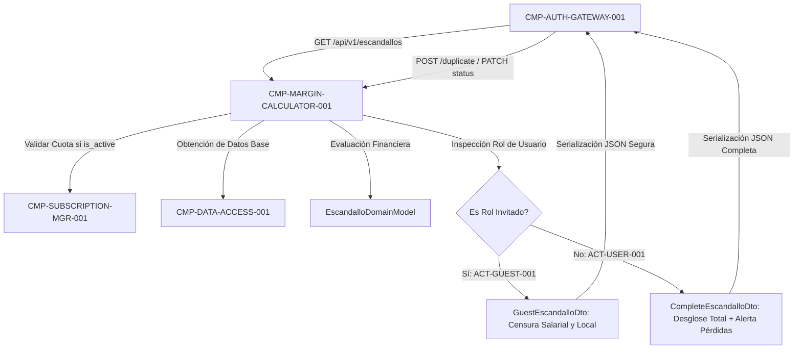

# CMP-MARGIN-CALCULATOR-001: Motor de Escandallo y Matriz de Rentabilidad

## 1. Propósito, Responsabilidad y Contexto Delimitado
Implementa el motor financiero puro para la formulación de servicios y el cálculo matemático de escandallos conforme a las reglas `BR-COST-FORMULA-001` y `BR-COLOR-THRESHOLDS-001`:
1. **Cálculo de Coste Unitario**: Suma exacta de minutos de mano de obra del profesional ($C_{personal}$), minutos de gastos generales imputables al tratamiento ($C_{local}$) y consumos netos de producto cosmético con su tasa de merma ($C_{consumibles}$).
2. **Tipos Impositivos (IVA)**: Aplicación flexible del 21% (general estética), 10% (reducido) o 0% (exento médico-sanitario).
3. **Precios y Márgenes**: Cálculo de precio base sugerido al 50.0% de beneficio, PVP final y evaluación de margen neto porcentual expresado estrictamente en tanto por 100 ($0.0\%-100.0\%$), con unidades de medida explícitas en todos los campos (`€`, `min`, `ml`, `ud`, `g`, `%`).
4. **Semáforo Visual y Alerta de Pérdidas (`BR-COLOR-THRESHOLDS-001`, `BR-COST-FORMULA-001`)**:
   - 🔴 **Rojo**: Margen $< 20.0\%$.
   - 🟡 **Amarillo**: Margen entre $20.0\%$ y $39.9\%$.
   - 🟢 **Verde**: Margen $\ge 40.0\%$.
   - **Alerta de Venta a Pérdidas**: Si el margen neto es negativo ($< 0.0$ €), genera obligatoriamente el mensaje de advertencia `lossWarningMessage: "Atención: Estás perdiendo X,XX € por cada sesión"`.
5. **Duplicación y Gestión de Estados**:
   - Soporte para clonación completa de servicios existentes (`POST /api/v1/escandallos/{id}/duplicate`), copiando tiempos, categoría profesional y consumos cosméticos.
   - Estado activo/inactivo (`is_active = true / false`) para gobernar el catálogo dentro del límite freemium.
6. **Censura Estricta en Backend para Invitados (`BR-GUEST-CENSOR-001`, `SEC-REQ-DATA-CENSOR-GUEST-001`)**: Proyección obligatoria de respuestas JSON mediante `GuestEscandalloDto` cuando el rol de la petición es `ACT-GUEST-001`, eliminando por completo en origen los campos salariales de trabajadores y costes estructurales del local.

## 2. Diagrama Estructural y de Conectividad (arc42 Sec. 5 / NAF v4)

## 3. Contratos de Interfaz y Políticas de Ejecución
- **Mecanismo de Ejecución**: Dominio in-process puro y controladores clásicos REST en ASP.NET Core (`EscandalloController` con `[ApiController]` en .NET 10). Ejecución en memoria sin I/O bloqueante durante los cálculos numéricos de alta velocidad.
- **Tolerancia a Fallos y Rendimiento**: Tiempo de cálculo por escandallo $< 1$ ms; sin fugas de datos sensibles en serialización DTO gracias a mapeadores estáticos fuertemente tipados.

---

## 4. Historial de Revisiones

| Versión | Fecha | Autor / Agente | Descripción del Cambio | Referencia |
| :--- | :--- | :--- | :--- | :--- |
| **1.0.0** | 2026-10-15 | `agent-system-architect` | Definición de componente de cálculo de escandallo, rentabilidad y censura | CHG-ARCH-001 |
| **1.1.0** | 2026-10-15 | `agent-system-architect` | Incorporación de umbrales 40%/20%, alerta explícita de pérdidas, duplicación y unidades explícitas | CHG-ARCH-001 |
