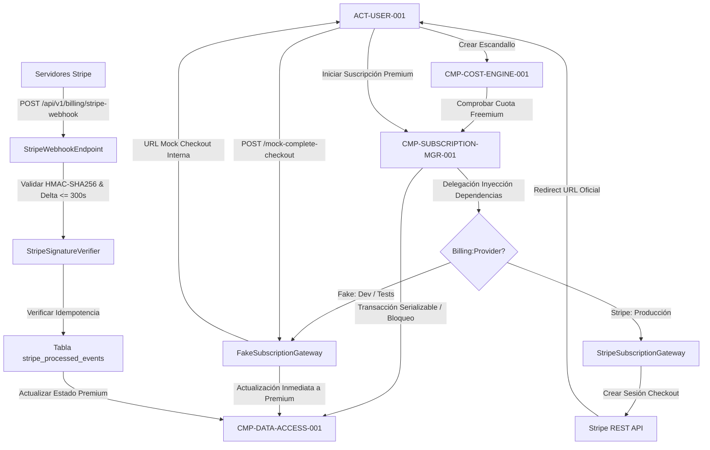

# CMP-SUBSCRIPTION-MGR-001: Gestor de Monetización, Cuota Freemium y Pasarela Stripe

## 1. Propósito, Responsabilidad y Contexto Delimitado
Gestiona la lógica comercial y de suscripciones de la plataforma:
1. **Control de Cuota Freemium (`BR-FREEMIUM-LIMIT-001`)**: Restringe a un máximo estricto de 2 escandallos activos (`is_active = true`) por centro en planes `Free`. Los escandallos desactivados/archivados no computan para el límite. Si un centro en plan Free ya cuenta con 2 escandallos activos, cualquier intento de **crear**, **activar** o **duplicar como activo** un servicio es interceptado y bloqueado inmediatamente con error `QUOTA_EXCEEDED` (HTTP 402/403).
2. **Protección Transaccional Anti-Carrera (`SEC-REQ-QUOTA-BACKEND-ENFORCE-001`)**: Valida atómicamente la cuota freemium (`SELECT COUNT(*) FROM services WHERE center_id = @id AND is_active = true`) en la base de datos utilizando transacciones con bloqueo pesimista o nivel de aislamiento `Repeatable Read` / `Serializable`, neutralizando ataques de carrera concurrente (TOCTOU) que intenten registrar o duplicar múltiples escandallos en paralelo.
3. **Abstracción de Pasarela de Pagos (`ISubscriptionGateway` / ADR-007)**:
   - **`StripeSubscriptionGateway` (Producción)**: Emite sesiones de Stripe Checkout para suscripciones recurrentes (mensuales/anuales) y gestiona el Customer Portal oficial.
   - **`FakeSubscriptionGateway` (Desarrollo / Tests / Mocks)**: Permite probar de forma hermética el flujo completo de suscripción, emitiendo URLs de checkout de prueba internas y permitiendo activar o cancelar planes Premium mediante endpoints de simulación sin conexión a Internet ni cuentas de Stripe.
4. **Receptor Webhook Blindado (`SEC-REQ-STRIPE-SIGNATURE-001`)**: Endpoint perimetral `/api/v1/billing/stripe-webhook` que verifica obligatoriamente la cabecera criptográfica `Stripe-Signature` mediante HMAC-SHA256, comprueba que la marca temporal esté dentro de una ventana máxima de 300 segundos (anti-replay attacks) y registra el identificador de evento en la tabla `stripe_processed_events` para garantizar procesamiento idempotente.

## 2. Diagrama Estructural y de Conectividad (arc42 Sec. 5 / NAF v4)

## 3. Contratos de Interfaz y Políticas de Ejecución
- **Mecanismo de Ejecución**: Controlador clásico ASP.NET Core (`BillingController` con `[ApiController]`) en `SEC-ENC-PAYMENT-INTEGRATION-001`.
- **Conmutación de Proveedor**: Configurado en `appsettings.json` mediante `Billing:Provider = "Fake" | "Stripe"`. En `Production`, el proveedor `Stripe` es forzoso y los endpoints de simulación mock devuelven `404 Not Found`.
- **Tolerancia a Fallos y Rendimiento**: Descarte inmediato de webhooks repetidos sin costo de CPU; respuesta 200 OK rápida a Stripe; soporte integral de pruebas automatizadas y desacopladas en pipelines CI.

---

## 4. Historial de Revisiones

| Versión | Fecha | Autor / Agente | Descripción del Cambio | Referencia |
| :--- | :--- | :--- | :--- | :--- |
| **1.0.0** | 2026-10-15 | `agent-system-architect` | Definición de gestor de suscripciones, freemium y webhooks Stripe | CHG-ARCH-001 |
| **1.1.0** | 2026-10-15 | `agent-system-architect` | Adición de abstracción `ISubscriptionGateway` y proveedor Fake/Mock (ADR-007) | CHG-ARCH-001 |
