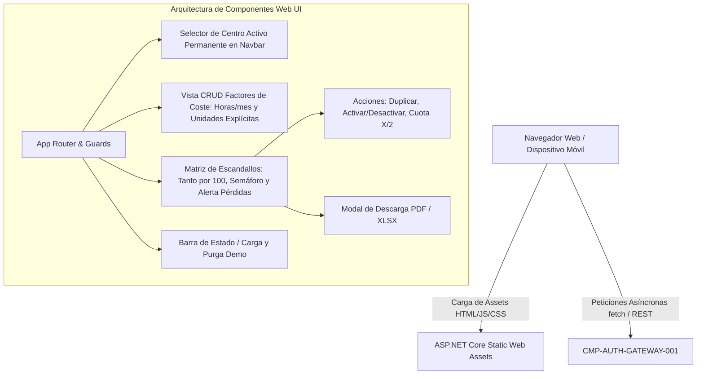

# CMP-WEB-UI-001: Interfaz de Usuario Web Responsiva SPA

## 1. Propósito, Responsabilidad y Contexto Delimitado
Proporciona la experiencia visual y de usuario de la plataforma web en navegadores modernos (móvil, tablet y escritorio):
1. **Selector de Centros y Gestión de Sesión (`UC-AUTH-MULTI-001`, `FR-AUTH-MULTI-001`)**: Permite cambiar de centro asignado de forma interactiva y actualiza el encabezado de contexto en las llamadas a la API. El nombre del centro activo se muestra de forma permanente y prominente en la barra de navegación superior (Navbar) para prevenir errores de sede.
2. **Formularios de Configuración de Costes (`UC-COST-CONFIG-001`, `FR-COST-CONFIG-001`)**: Pantallas ágiles con validación en cliente que solicitan directamente las **Horas de apertura mensuales (`h/mes`)** (con valor estándar de 176 h/mes) y calculan automáticamente los minutos de apertura. **Todos los valores configurables y calculados muestran su unidad de medida explícita** (`h/mes`, `min`, `€`, `€/mes`, `€/min`, `ml`, `ud`, `g`, `%`).
3. **Matriz de Servicios, Semáforos y Alerta de Pérdidas (`UC-SERVICE-MARGIN-001`, `FR-SERVICE-MARGIN-001`)**: Listado tabular de tratamientos con visualización instantánea del escandallo, cálculo de PVP según IVA (21%, 10%, 0%), **porcentajes formateados estrictamente en tanto por 100** ($0.0\%-100.0\%$), badges de color (`BR-COLOR-THRESHOLDS-001`: verde $\ge 40\%$, amarillo $20\%-40\%$, rojo $<20\%$) y **alerta explícita de venta a pérdidas** en rojo si el beneficio es negativo (`"Atención: Estás perdiendo X,XX € por cada sesión"`).
4. **Acciones de Duplicación y Activación**: Cada servicio dispone de acciones rápidas para **Duplicar** ("Copia de...") y conmutar estado **Activo / Inactivo**.
5. **Control Visual de Cuota Freemium (`BR-FREEMIUM-LIMIT-001`)**: Indicador visible en cabecera del listado (`Escandallos activos: X/2 (Plan Free)`). Si se alcanza 2/2, el botón `+ Nuevo Escandallo` y la acción `Duplicar` activan preventivamente el modal de suscripción a Premium.
6. **Exportación Ejecutiva (`UC-EXPORT-EXEC-001`, `FR-EXPORT-EXEC-001`)**: Botonera para descarga inmediata de informes en PDF y Excel con un clic.
7. **Adaptación a Rol Invitado (`BR-GUEST-CENSOR-001`)**: Oculta controles de edición financiera estructural y presenta exclusivamente los datos de consumos permitidos por el backend.
8. **Huella Mínima de Infraestructura (`QR-DEPLOY-COST-001`)**: Bundle de cliente optimizado servido estáticamente por el host ASP.NET Core sin necesidad de servidores adicionales de renderizado (SSR pesado), manteniendo el coste operativo global en < 10-15 €/mes.

## 2. Diagrama Estructural y de Conectividad (arc42 Sec. 5 / NAF v4)

## 3. Contratos de Interfaz y Políticas de Ejecución
- **Mecanismo de Ejecución**: Aplicación web SPA estática (Vite + React / TypeScript o Blazor WebAssembly) compilada y embebida en la imagen Docker de producción.
- **Tolerancia a Fallos y Rendimiento**: Tiempo de carga inicial (LCP) $< 1.5$ s; manejo grácil de desconexión mediante indicadores visuales de error de red.

---

## 4. Historial de Revisiones

| Versión | Fecha | Autor / Agente | Descripción del Cambio | Referencia |
| :--- | :--- | :--- | :--- | :--- |
| **1.0.0** | 2026-10-15 | `agent-system-architect` | Definición de componente de interfaz de usuario web SPA | CHG-ARCH-001 |
