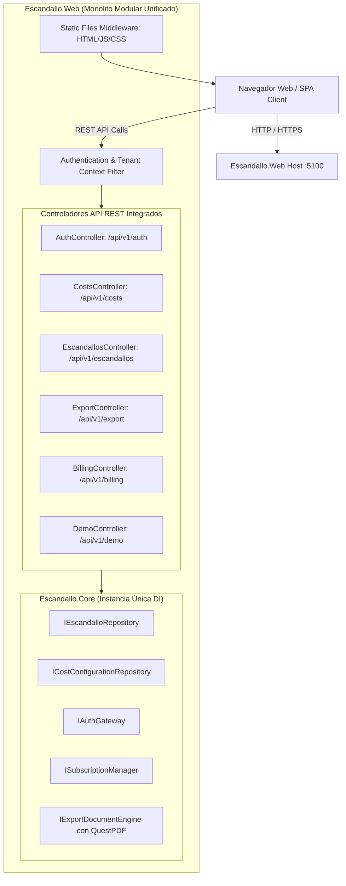
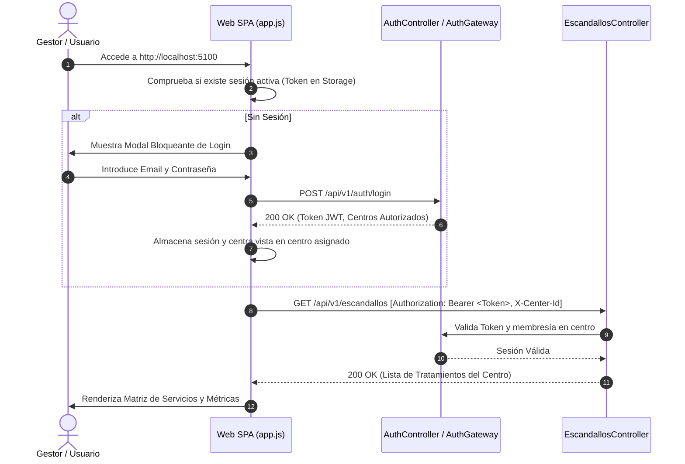

# Diseño Técnico de Remediación (`CHG-REMEDIATION-001`)

## 1. Topología de Componentes y Hosting Unificado

Para resolver el problema del proxy inverso caído y la duplicación de repositorios en memoria (*Split-Brain*), se unifica el runtime de ASP.NET Core:



### Directivas de Host
- `Escandallo.Web/Program.cs` registrará `builder.Services.AddControllers()` y mapeará `app.MapControllers()`.
- Se elimina el proxy inverso hacia `:5000`.
- El mismo proceso sirve tanto los activos web (`index.html`, `app.js`, `app.css`) como los endpoints REST de `/api/v1/*`.
- Todos los repositorios residen en un único contenedor de inyección de dependencias (`Singleton`), asegurando consistencia inmediata del estado.

---

## 2. Flujo de Autenticación y Guard de Navegación

### Diagrama de Secuencia de Login y Acceso


### Especificación del Guard de Cliente (`app.js`)
- Si no hay token de autenticación en `sessionStorage`/`localStorage`:
  - Ocultar matriz principal de centros y navegación.
  - Mostrar modal no cerrable de Login.
  - Al completar login exitoso, cargar los centros autorizados en el selector del Navbar.
  - Enviar en toda petición subsecuente las cabeceras:
    `Authorization: Bearer <token>` y `X-Center-Id: <activeCenterId>`.

---

## 3. Contratos de Costes de Personal y Cosméticos

Se completan los contratos OpenAPI de [`specs/architecture/contracts/costs-api.json`](file:///c:/Users/reypo/Documents/Workspace/EscandalloFull/specs/architecture/contracts/costs-api.json):

### 3.1 Endpoints de Personal (`/api/v1/costs/workers`)
* `GET /api/v1/costs/workers`: Retorna la lista de categorías activas con su coste de empresa mensual y coste por minuto computado.
* `POST /api/v1/costs/workers`: Da de alta una nueva categoría profesional:
  ```json
  {
    "categoryName": "Técnico Superior",
    "monthlyCompanyCost": 2340.00
  }
  ```
  El backend calcula el coste por minuto dividiendo entre los minutos de apertura mensuales configurados para el centro ($M_{mes}$).

### 3.2 Endpoints de Productos Cosméticos (`/api/v1/costs/products`)
* `GET /api/v1/costs/products`: Lista el catálogo de cosméticos del centro.
* `POST /api/v1/costs/products`: Registra un producto cosmético:
  ```json
  {
    "name": "Leche Limpiadora Profunda",
    "packagePrice": 36.00,
    "capacity": 500,
    "unitOfMeasure": "ml",
    "wastePercentage": 5.0
  }
  ```
* `PUT /api/v1/costs/products/{id}`: Actualiza el precio de compra del producto.

### 3.3 Interfaz de Usuario Multitab
En la columna izquierda de la UI, se incorporan pestañas de navegación:
1. **Pestaña Gastos Generales**: Horas de apertura, alquiler, suministros, consumibles de cabina.
2. **Pestaña Personal**: Tabla de roles con coste empresa y coste/minuto. Formulario para añadir puesto.
3. **Pestaña Cosméticos**: Tabla de productos con envase, precio, merma y coste unitario neto. Formulario de alta.

---

## 4. Motor de Generación PDF Real (QuestPDF Sandbox)

Conforme a [`ADR-005`](file:///c:/Users/reypo/Documents/Workspace/EscandalloFull/specs/architecture/ADR-005-DOCUMENT-EXPORT-SANDBOX.md):
- Se añade la dependencia `QuestPDF` a `Escandallo.Core.csproj`.
- Se implementa `ExportDocumentEngine.ExportPdf()` generando un documento binario profesional:
  - Encabezado corporativo con nombre del centro y fecha de emisión.
  - Tabla estilizada con Tratamiento, Duración, Mano de Obra, Gastos Generales, Cosméticos, Coste Total, PVP y Margen Neto.
  - Badges coloreados según el semáforo de rentabilidad (Verde, Amarillo, Rojo).
  - Sanitización de celdas mediante comilla simple (`'`) contra inyección de fórmulas.
  - Desconexión estricta de red para prevenir ataques SSRF.
