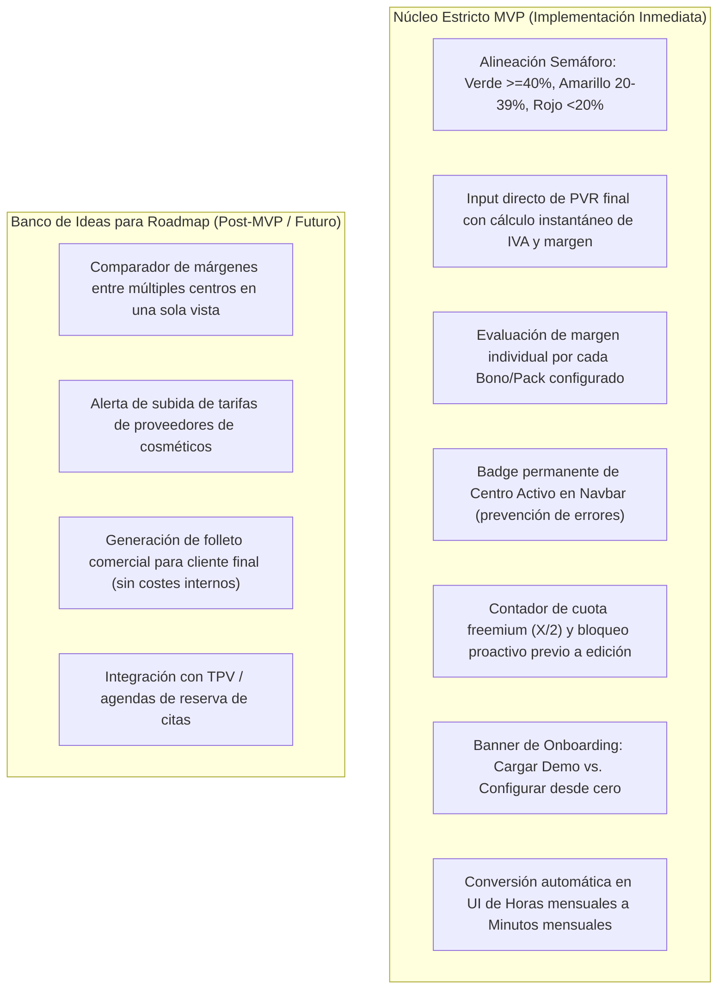

# Informe de Auditoría de Diseño y Usabilidad (`UDF-DESIGN-AUDIT-001`)

> **Rol Auditor**: `agent-expert-user` (Experto de Dominio y Evaluador de Usabilidad)  
> **Fecha de Evaluación**: 15 de Octubre de 2026  
> **Persona Evaluada**: `ACT-USER-001` (Propietario / Director Técnico de Centro de Estética en condiciones de campo: cabina, recepción, iPad/Móvil, estrés e interrupciones)

---

## 1. Veredicto Ejecutivo Global

El diseño funcional y arquitectónico del sistema es **SÓLIDO, COHERENTE y FINANCIERAMENTE PRECISO**. La fórmula de tres pilares (Gastos Generales por minuto, Personal por minuto y Cosméticos con merma) resuelve con fidelidad la casuística de los salones de belleza y clínicas médico-estéticas.

Sin embargo, para garantizar una adopción exitosa sin fricción ni abandono en condiciones operativas reales, se han identificado **5 puntos de fricción de usabilidad críticos** que deben integrarse en el MVP estricto, así como discrepancias menores en los umbrales del semáforo visual entre la UI y las reglas de negocio.

---

## 2. Auditoría Detallada por Eje de Evaluación

### Eje 1: Flujos de Cálculo y Formulación del Escandallo (`BR-COST-FORMULA-001`, `UC-SERVICE-MARGIN-001`)

| Elemento Evaluado | Observación de Campo (Estrés / Realidad de Salón) | Diagnóstico | Recomendación / Veredicto |
| :--- | :--- | :---: | :--- |
| **Prorrateo de Gastos Generales** | En cabina nadie calcula "minutos de apertura al mes". Un salón abre de lunes a viernes (ej. 8h/día) o incluye sábados (ej. 4h/día). | **Aceptable con mejora UX** | En la pantalla de configuración, permitir introducir **Horas de apertura mensuales** (o días/semana + horas/día) y que el sistema convierta automáticamente a minutos ($H \times 60$). Evita errores de cálculo mental. |
| **Consumos y Mermas de Cosméticos** | En cabina, teclear productos desde un desplegable largo mientras atiendes a un cliente es lento. | **Aceptable** | Implementar selector con autocompletado rápido (*Combobox/Typeahead*). Sugerir dosis estándar y mantener merma al $0\%$ para viales y $5\%-10\%$ para tarros/dosificadores. |
| **Entrada de Precio de Venta (PVR)** | La dueña de salón fija mentalmente el precio final con IVA incluido (ej. "Cobro 65 € por sesión"). No calcula el precio base sin IVA de antemano. | **Excelente** | El flujo diseñado en `BR-COST-FORMULA-001` donde el usuario introduce el PVR final con IVA y el sistema deduce el IVA, beneficio absoluto en € y margen porcentual real es **100% intuitivo y perfecto**. |
| **Rentabilidad de Bonos y Packs** | Los bonos de 5 o 10 sesiones concentran hasta el 60% de la facturación en salones. Poner precios de bonos a ojo suele provocar pérdidas graves no detectadas. | **Excelente (Diferenciador)** | La inclusión de la rentabilidad y semáforo individual por cada Bono en la misma pantalla es un acierto de negocio imprescindible para el MVP. |
| **Umbrales del Semáforo Visual** | Discrepancia detectada: `BR-COLOR-THRESHOLDS-001` establece Verde $\ge 40\%$ y Rojo $<20\%$. En cambio, `CMP-WEB-UI-001` mencionaba Verde $\ge 50\%$ y Rojo $<35\%$. | ⚠️ **Inconsistencia Detectada** | **Corrección Inmediata**: La UI debe ceñirse estrictamente a los umbrales de la regla de negocio: **Verde $\ge 40\%$**, **Amarillo $20\%-39.9\%$** y **Rojo $<20\%$**. |

---

### Eje 2: Selector Multicentro y Aislamiento de Datos (`UC-AUTH-MULTI-001`, `CMP-WEB-UI-001`)

| Elemento Evaluado | Observación de Campo | Diagnóstico | Recomendación / Veredicto |
| :--- | :--- | :---: | :--- |
| **Usuario con 1 solo centro** | El 80% de los usuarios solo tienen un local. Ver un selector de centros añade ruido visual y confusión. | **Excelente** | La regla de omitir el selector y entrar directo al centro único es impecable. |
| **Visibilidad de Centro Activo** | Una gestora con varios centros (ej. Centro Norte y Centro Sur) puede equivocarse de centro y cambiar precios en el local erróneo. | **Riesgo Operativo Alto** | En la cabecera (Navbar) debe figurar **permanentemente visible** el nombre del centro activo con un badge prominente. El cambio de centro en el desplegable debe refrescar la vista en caliente sin perder la pantalla actual ni requerir re-login. |
| **Rol Invitado (`ACT-GUEST-001`)** | Las empleadas consultan el tratamiento para ver la técnica y dosis de crema, pero no deben ver los salarios ni el beneficio neto del dueño. | **Excelente** | La censura en backend de datos estructurales y márgenes es obligatoria y está perfectamente planteada. |

---

### Eje 3: Experiencia de Usuario Demo y Cuota Freemium (`BR-DEMO-DATA-001`, `BR-FREEMIUM-LIMIT-001`)

| Elemento Evaluado | Observación de Campo | Diagnóstico | Recomendación / Veredicto |
| :--- | :--- | :---: | :--- |
| **Arranque en Blanco (*Clean Slate*)** | Un centro recién creado que aparece completamente a 0 (sin gastos, sin cosméticos, sin servicios) produce parálisis y sensación de aplicación vacía. | **Fricción de Onboarding** | El cumplimiento de `BR-DEMO-DATA-001` es correcto, pero la UI debe mostrar un **Banner de Bienvenida Proactivo** con dos botones claros:  1. *"🚀 Probar con datos de ejemplo (Modo Demo)"* 2. *"✍️ Configurar mi centro paso a paso"*. |
| **Purga de Datos de Demo** | El usuario prueba con los datos de demo de la Excel y luego quiere borrarlos para empezar en limpio con sus datos reales. | **Excelente** | El botón *"Eliminar datos de prueba e iniciar centro en blanco"* debe incluir confirmación modal con advertencia clara para evitar borrados accidentales de datos reales. |
| **Compuerta Freemium (Límite 2 Escandallos)** | Si el usuario invierte 10 minutos rellenando el formulario de su 3er escandallo y al darle a "Guardar" el sistema le suelta un error bloqueante, se sentirá engañado y abandonará la web. | 🔴 **Fricción Crítica de Conversión** | **Mejora Obligatoria de Usabilidad**:  1. Mostrar en el panel de servicios un contador sutil: *"Escandallos activos: 1/2 (Plan Free)"*. 2. Al alcanzar 2/2, el botón *"+ Nuevo Escandallo"* debe mostrar un icono de candado o distintivo *Premium*, y al hacer clic abrir directamente el modal de suscripción antes de abrir el formulario de edición. 3. Permitir desactivar/archivar un escandallo para crear otro sin borrarlo. |
| **Simulación de Pago Mock/Fake** | Probar la pasarela sin tarjetas reales ni internet. | **Excelente** | La arquitectura con `FakeSubscriptionGateway` y endpoints de simulación (`/mock-complete-checkout`, `/mock-cancel-subscription`) permite validar la experiencia de usuario y desbloqueo de cuota de forma determinista y fluida. |

---

## 3. Discriminación Bimodal: MVP Estricto vs. Roadmap Futuro

### 3.1 Requisitos del Núcleo Estricto MVP
1. **MVP-USAB-01 (Semáforo Unificado)**: Corregir en la vista de usuario los rangos del semáforo: $\ge 40\%$ Verde, $20\%-39.9\%$ Amarillo, $<20\%$ Rojo.
2. **MVP-USAB-02 (Contador Freemium Preventivo)**: Visualizar `X / 2 escandallos activos` en la lista de servicios. Si la cuota está completa, el botón de crear servicio despliega directamente la propuesta de valor Premium y botón de suscripción.
3. **MVP-USAB-03 (Selector Multicentro Seguro)**: Mantener el nombre del centro seleccionado fijo y visible en el encabezado en todo momento.
4. **MVP-USAB-04 (Facilidad de Entrada de Horas)**: El formulario de gastos generales debe aceptar horas de apertura mensuales y multiplicarlas por 60 en segundo plano.
5. **MVP-USAB-05 (Banner Demo / Limpieza Clara)**: Presentar la carga y purga de demo de manera inequívoca y reversible.

### 3.2 Sugerencias Diferidas para el Roadmap (Fuera de Alcance MVP)
- **ROADMAP-01 (Analítica Comparativa Multisede)**: Cuadro de mando consolidado para cadenas que compare el coste medio por minuto de local y personal entre centros.
- **ROADMAP-02 (Gestión de Mermas Dinámicas)**: Registro de mermas reales por pesaje de envases vacíos frente a la merma teórica.
- **ROADMAP-03 (Exportación a Tarifa de Precios Comercial)**: Generar PDF estilizado con PVP y descripción del tratamiento listo para imprimir o enviar por WhatsApp a clientes finales.

---

## 4. Decisiones de Producto y Diseño Aprobadas (`resolved-decisions`)

1. **Gestión de Escandallos Inactivos en Plan Free**:
   - **Decisión del Usuario**: *"Puede desactivar"*.
   - **Especificación**: Se permite desactivar escandallos (`is_active = false`). El límite de 2 en el plan Free evalúa únicamente escandallos activos.
2. **Duplicación de Servicios**:
   - **Decisión del Usuario**: *"Se debe permitir duplicar un servicio existente. Bloqueado en caso de plan gratuito con 2 escandallos activos"*.
   - **Especificación**: Se incorpora la acción de clonación completa (`POST /api/v1/escandallos/{id}/duplicate`), sujeta a la compuerta freemium si se intenta crear como activo.
3. **Cálculo de Horas de Apertura y Unidades de Medida**:
   - **Decisión del Usuario**: *"Ok, implementar la recomendación"* y *"Todos los valores configurables deben aparecer con su unidad de medida"*.
   - **Especificación**: Se solicita `Horas/mes de apertura` (`h/mes`, por defecto 176 h) convirtiendo a minutos ($H \times 60$). Todos los campos configurables y calculados muestran su unidad explícita (`h/mes`, `min`, `€`, `€/mes`, `€/min`, `ml`, `ud`, `g`, `%`).
4. **Alerta Visual de Margen Negativo (Venta a Pérdidas)**:
   - **Decisión del Usuario**: *"Ok"*.
   - **Especificación**: Si el margen es negativo, se muestra obligatoriamente el semáforo rojo y un mensaje explícito: `Atención: Estás perdiendo X,XX € por cada sesión`.
5. **Formato de Porcentajes**:
   - **Decisión del Usuario**: *"Los % deben mostrarse en tanto por 100 y no en tanto por 1"*.
   - **Especificación**: Todos los porcentajes (márgenes, IVA, merma, beneficio) se formatean e introducen en base 100 con símbolo `%` (ej. 50.0%, 21.0%, 5.0%).

---

## 5. Historial de Revisiones

| Versión | Fecha | Autor / Rol | Descripción del Cambio |
| :--- | :--- | :--- | :--- |
| **1.0.0** | 2026-10-15 | `agent-expert-user` | Auditoría de diseño de usabilidad de cálculo, multicentro y experiencia demo/freemium |
| **1.1.0** | 2026-10-15 | `agent-system-architect` | Incorporación de decisiones del usuario: desactivación, duplicación, horas mensuales, unidades explícitas y tanto por cien |
